

  

# What's new

The newest version is at the top. Every release is on the [Releases page](https://github.com/Dextron04/dex-notch/releases), where you can download it.

## v0.9.6: Screen answers stay out of your way

*Not released yet*

**Answers about your screen now appear on the screen.** The notch used to hang down over the page you were asking about. Now, when an answer points at things, the notch folds away as soon as it finishes and each explanation shows as a speech bubble tied to its numbered box. Claude and Codex pick blank space for the bubbles, and Dex Notch moves any that would cover a box, another bubble or the notch. Open the notch again to ask a follow-up: the highlights go away, and the conversation and the same screenshot are still there.

## v0.9.5: Ask about your screen, and get both models' best answer

*20 November 2026*

Two things. You can show Claude or Codex your screen and ask about it, and you can ask both models at once and get one answer that keeps the best of each.

**Ask about your screen.** Answers can point at the exact spot with numbered boxes drawn over the real screen.

- **Show your screen with one key.** Press `⌥⌘S`, or click the eye in the prompt bar. A small thumbnail shows what the model will see. Only the screen the notch is on is captured, and Dex Notch's own window is left out.
- **Or just ask.** Plain words like "what's on my screen?" take a single screenshot for that one question. The eye flashes and turns itself off again.
- **Boxes drawn on your screen.** Ask "where is the Wi-Fi icon?" and a numbered box appears over it, with a line from the notch. The matching number is next to the answer. Boxes are click-through, so you can keep using whatever is under them. They go away when you press Esc, ask something new, or after a minute.
- **Models can look on their own.** When it helps, Claude and Codex can take a screenshot while they answer, up to three per question. The status line says "looked at your screen" each time. Turn it off in Settings → Models with "Let models look at the screen on their own".
- **Screenshots do not pile up.** A screenshot lives in the run's private scratch folder, readable only by you. A one-question screenshot is deleted when the answer ends, the eye's screenshot when you turn the eye off or start a new chat, and any left over are removed when Dex Notch starts or quits. Nothing is kept or uploaded by Dex Notch itself.
- **Needs Screen Recording.** The first time you use it, macOS asks you to allow Dex Notch under System Settings → Privacy & Security → Screen Recording. Nothing is captured until you allow it. The local model (Gemma) can't see the screen, so the eye is dimmed for it.

  

    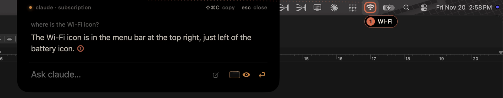
  

  

    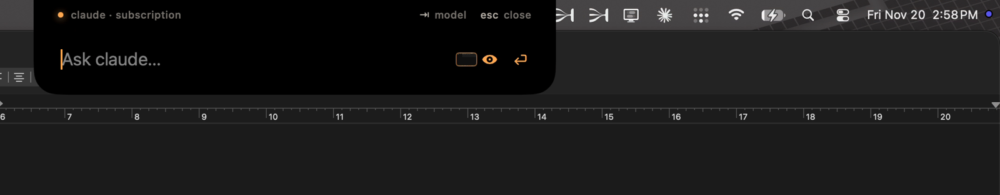
  

  

    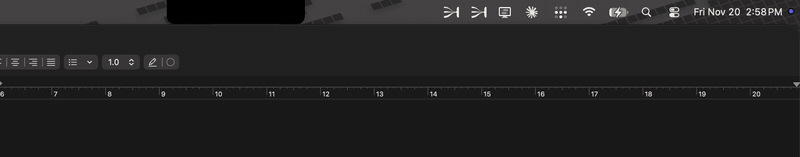 
    <a href="docs/assets/gif-screen-help.mp4">Watch it as a video</a>
  

**Ask Claude and Codex together.** Press Tab to **Both** (or start with `@both`) when both CLIs are installed. Each model answers, each judges the other's answer, the preferred model writes a hybrid that keeps the best of both, and the other model reviews it. A stage track shows the progress and a verdict line says who won. It takes about 20 seconds and six CLI runs per question, and it is always read-only. With a screenshot (the eye, `⌥⌘S` or "my screen"), both models get it. The boxes on your screen come only from the final answer, and the three looks per question are shared between them.

  

    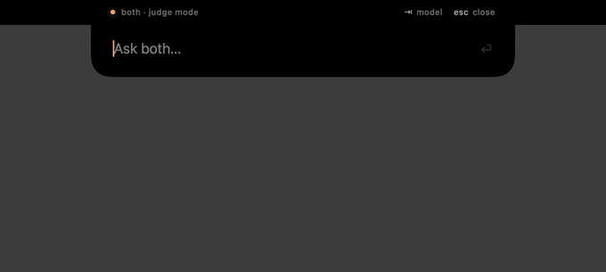 
    <a href="docs/assets/gif-dual-judgement.mp4">Watch it as a video</a>
  

## v0.9.4: Tighter limits on what Claude can reach

*20 November 2026*

This release is mostly about safety. It closes off places where an AI helper, or a hostile email, could have reached further than you meant. It does not make the AI risk-free: [SECURITY.md](SECURITY.md) says exactly what is covered and what is not.

**In the Mac app (this update)**

- **Ask mode can only read its own scratch folder.** Claude can no longer read your files from Ask mode. Folders that hold secrets are blocked: `~/.ssh`, `~/.aws`, Keychains, tokens, npm and git credentials, shell history, Messages, Mail and browser profiles. Of your connected tools, only Dex Memory is reachable; your other MCP tools are not.
- **Work mode (`@claude+`) has no web tools.** Shell commands still run in the sandbox, with the same blocked folders.
- **Gmail replies go to exactly one address, shown in full**, as "Name <address>". If an email has several recipients, or hidden ones, Dex Notch refuses to reply and tells you why.

- **Judging mail with Codex runs with no tools and no MCP servers.** Prompts are passed after `--`. Claude's scratch folder is cleaned before every run, so links and planted settings files are removed.
- **Links in answers are safer.** Only http and https links can be clicked, and the host is shown, so you can see where a link goes.
- **Reminders tidy up after themselves.** Done and expired reminders are removed, so the folder no longer grows forever.
- **Fewer ways to lose things.** A damaged `addons.json` is set aside instead of wiped. Mac notifications waiting for the AI survive a restart. The recorder updates atomically and logs its first import to `backfill.log`.
- **Clearer wording.** "Lock your vault" now says "Create a passkey, or use a passphrase".

**On the website and server (already live, no update needed)**

- **Locking your vault is part of sign-up.** You create a passkey, or use a passphrase, before anything else.

  

    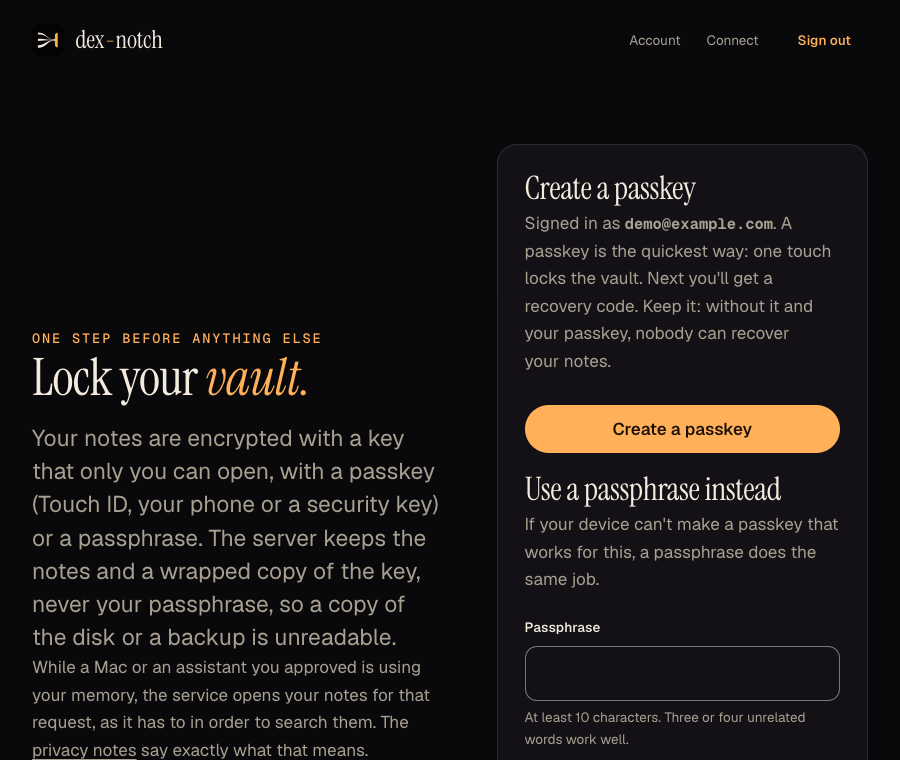
  

  

    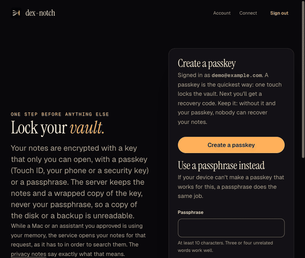 
    <a href="docs/assets/gif-vault-lock.mp4">Watch it as a video</a>
  

- **Stronger passphrase protection.** A passphrase is now turned into a key with a slower, memory-hungry method, which makes guessing it much more expensive.
- **Sign-in hardening.** The OAuth sign-in for Claude and ChatGPT accepts only exact return addresses, forms refuse to be sent from other sites, and responses can no longer be tampered with through injected headers.
- **Automatic, tested deploys with rollback.** New server versions are tested before they go live, and roll back by themselves if the health check fails.
- **Sign-in forms work in Chrome again.** A tightening this week made Chrome send a blank origin from our own pages, so the check refused them. The page policy is now "same-origin".

## v0.9.3: A fresher, clearer Settings window

*18 November 2026*

- **Settings has been redesigned from the top.** Every page now has an icon, a clear title and a one-line summary of what it is for, and related settings sit together on soft cards instead of one long list. A small dot beside a page in the sidebar means it has something for you to do: a reconnect on Mail, Full Disk Access on iPhone, an update ready to restart into, or your next step on Memory.

  

    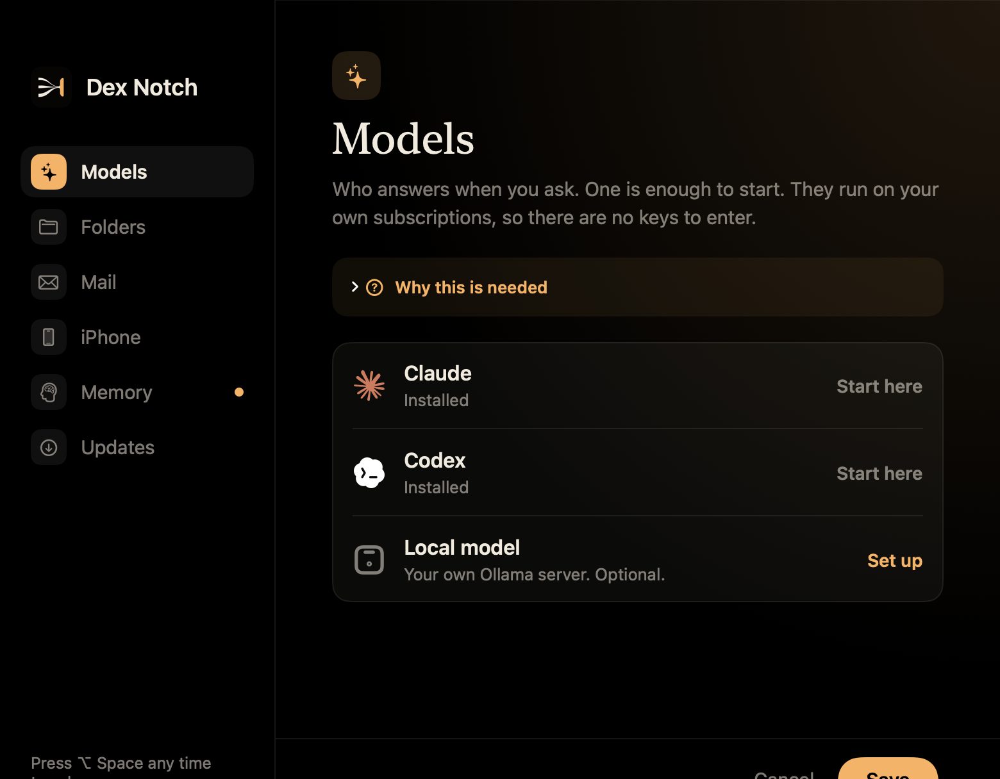
  

  

    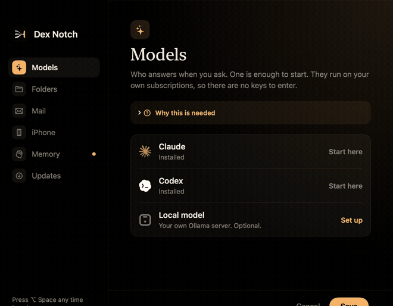 
    <a href="docs/assets/gif-settings.mp4">Watch it as a video</a>
  

- **Memory is easier to follow.** It used to be one long page. It now starts with the one thing to do next, in a highlighted card with the button that does it, then your account, recording, your connections to Claude and ChatGPT, and help, each in its own group. "Save every conversation" moved in with the connections, where it belongs.

  

    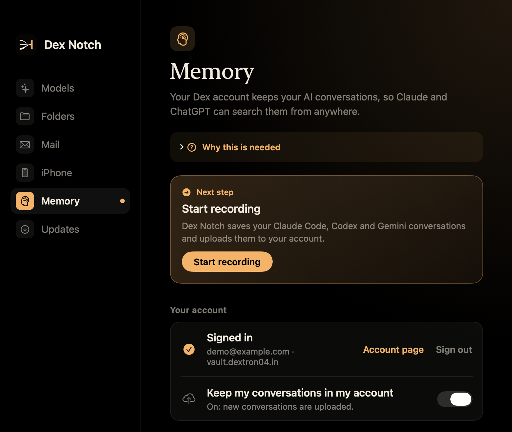
  

- **The "why" is there when you want it.** The explanation of why a permission is needed used to fill the top of every page. In Settings it is now a single quiet line, "Why this is needed", that opens when you click it. During first-time setup it stays open.

  

    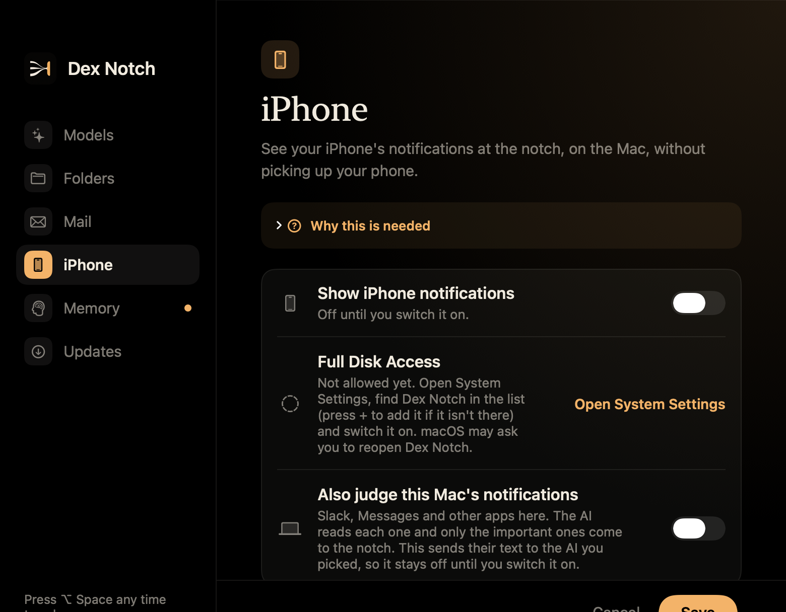
  

- **Smaller things.** Connect Gmail and Connect Outlook are real buttons. How often to look at your mail is a simple slider-style choice. Instructions that were cut off with "…", like the Full Disk Access steps, now show in full. The links in the help row no longer break into pieces. The first-run welcome uses the same look.
- **Also on the website, already live.** On a phone, the address you paste into ChatGPT now sits on one line with Copy under it, instead of breaking in the middle.

## v0.9.2: Honest ChatGPT steps, and Allow works with Touch ID

*18 November 2026*

- **The ChatGPT button says what it does.** ChatGPT has no one-click link the way Claude does, so **Connect** on the ChatGPT row could only open written steps, which looked like nothing had happened. It now reads **Show the steps**, and the steps put your address in a box with a **Copy** button right where you paste it. If Codex is installed, the same button still adds Dex Memory to Codex and opens its sign-in.

  

    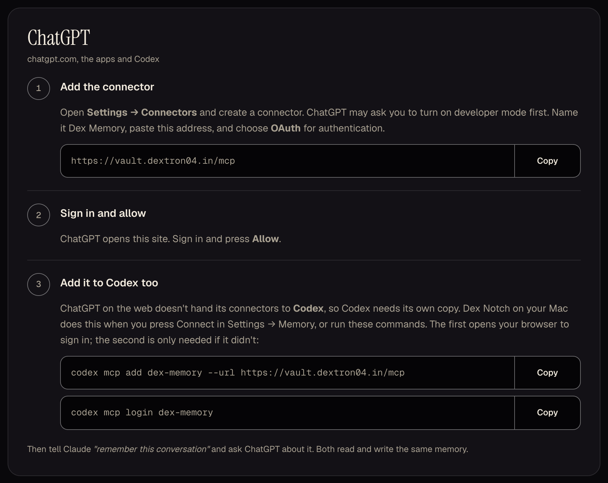
  

- **A tidier Connect page.** Each assistant card has its title and status on one line, the **Add to Claude** button in its own row with a line saying what it does, and a proper "Claude Code didn't pick it up?" row that opens smoothly. Commands wrap cleanly, or scroll on a phone, instead of breaking mid-flag.

  

    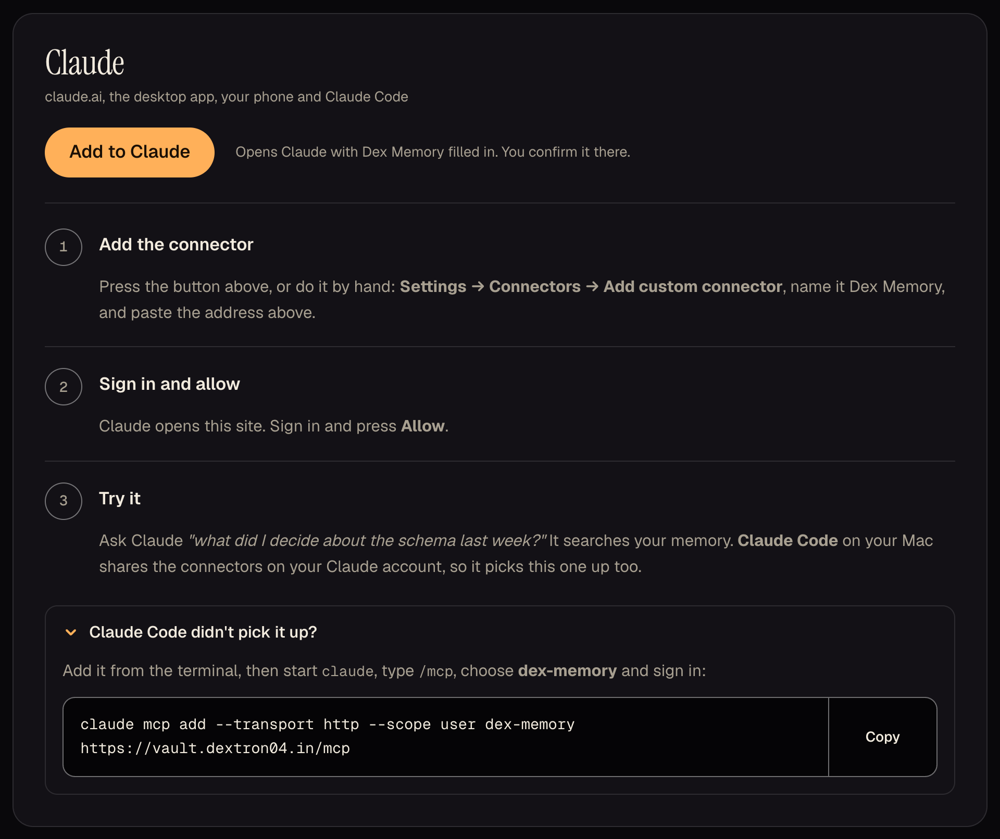
  

  

    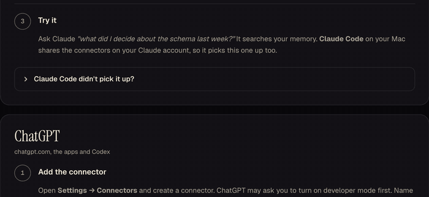 
    <a href="docs/assets/gif-connect.mp4">Watch it as a video</a>
  

- **Allow works if you locked your vault with Touch ID.** A vault made with a passkey has no passphrase, but the Allow page still asked for one you couldn't type, so pressing **Allow** appeared to do nothing. The page now asks for your touch, and Allow does the touch itself. The same goes for adding a Mac and downloading your data. This and the next point are on the website, so they are already live for everyone and need no update.
- **Codex and Claude Code can finish signing in.** Their sign-in returns to a local address on your own Mac, and the website's page policy blocked that final step even after the server accepted it. It now allows exactly that and nothing else.

## v0.9.1: One app to set up, and a guide for your first hour

*18 November 2026*

- **Dex Notch records your conversations by itself.** Until now the recorder was a separate install (a git clone and a script), so a new tester signed up and nothing uploaded. The app now carries it: after you sign up it starts a small helper in the background (Python, standard library only; it needs Python 3.9 or later, and tells you to run `xcode-select --install` if you have none), saves your Claude Code, Codex and Gemini conversations, uploads them, and imports your existing history once. **Settings → Memory → Record my conversations** shows whether it is running and stops it. If you already run the recorder from a checkout, the app leaves yours alone.
- **A Get started card shows what to do next, and does it.** In **Settings → Memory**: lock your vault, start recording, connect Claude or ChatGPT, then have your first conversation, with the exact two lines to paste. Your account page has the same five steps, ticked off by what has really happened (your first conversations uploaded, an assistant using your memory), not by what you clicked.

  

    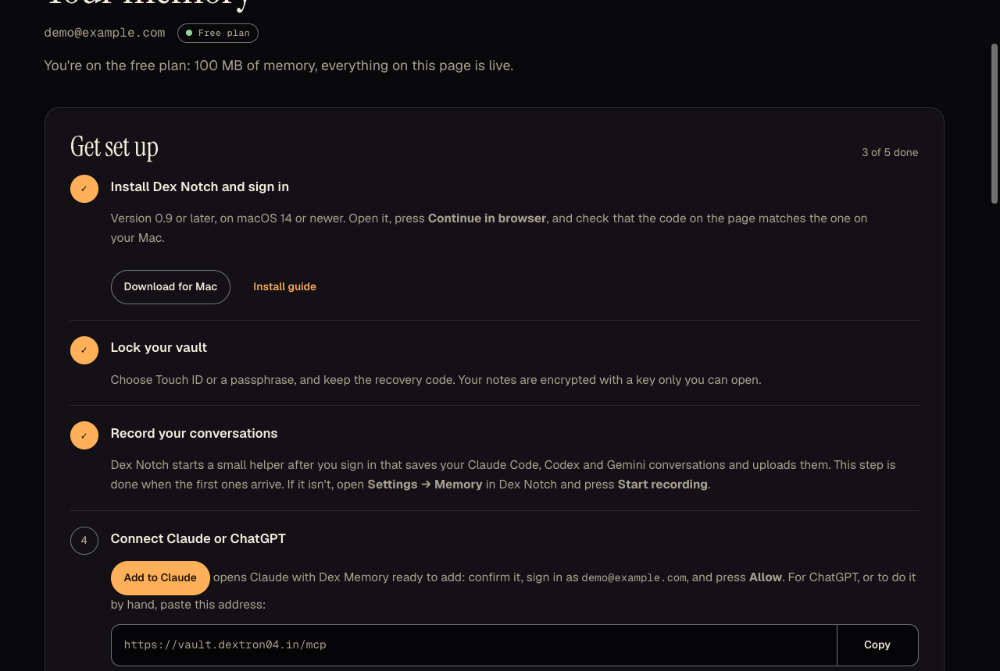
  

- **Connecting Claude is one click.** **Add in Claude** opens Claude's own add-a-connector dialog with Dex Memory and its address already filled in; you confirm it there. Claude Code uses the same connection, so Settings → Memory now has two rows, **Claude** (with Claude Code) and **ChatGPT** (with Codex). ChatGPT has no prefilled link, and ChatGPT on the web doesn't pass connectors on to Codex, so the ChatGPT button opens its steps and, if Codex is installed, adds Dex Memory to Codex too.

  

    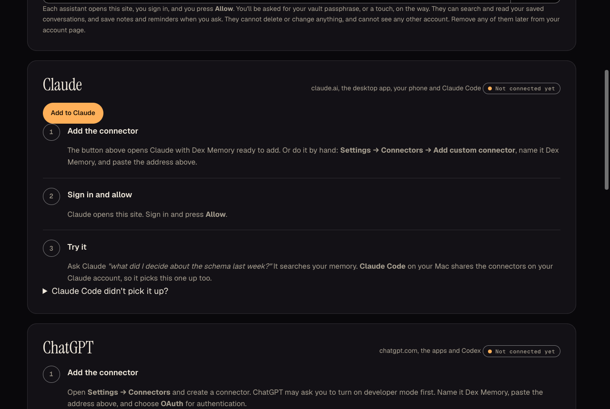
  

- **Codex and Claude Code can now actually sign in.** Their sign-in comes back to your own Mac (a local address, as the standard for command-line tools requires), and the server refused it, so `codex mcp add` ended in "registration failed" however carefully you set it up. The server now accepts it, only for the Mac itself and only with the usual safeguards, and the sign-in page says "Codex on this Mac". Tested with the real Codex, from registration to a signed-in `codex mcp list`.
- **Connection status you can trust.** Settings → Memory used to say "couldn't check" or "not connected" for things that were fine: it couldn't read the lines `claude mcp list` prints for servers added from the terminal, one failed look was remembered for six hours, a timeout threw away what had already been printed, and ChatGPT showed as unknown whenever Codex couldn't be checked. Each of those is fixed, the last good answer is kept, and a half-known row says what it does know.
- **Fewer repeats.** Choosing a passphrase signs you in to the vault for the next hour, so adding your Mac right afterwards doesn't ask for it again.
- **A full install guide**, [docs/install.md](docs/install.md): invitation to first conversation, what each step does, troubleshooting, uninstalling, building from source and running your own server. The invitation and welcome emails now walk through the same steps.

## v0.9.0: Locked vaults, an assistant checklist, and a page to connect them all

*17 November 2026*

- **Your notes are locked with a passphrase.** Before a Mac or an assistant can use your memory, you choose a passphrase (at least 10 characters) and get a recovery code. Notes are then encrypted on the server's disk with a key only your passphrase, your recovery code, or a Mac or assistant you approved can open, so a stolen backup or a copy of the disk is unreadable. It is **not end-to-end encrypted**: the service opens your notes while it answers you, and the names of notes (which assistant, which month, which project) stay readable. Lose your passphrase and your recovery code and the notes cannot be recovered. [PRIVACY.md](PRIVACY.md) has the details.

  

    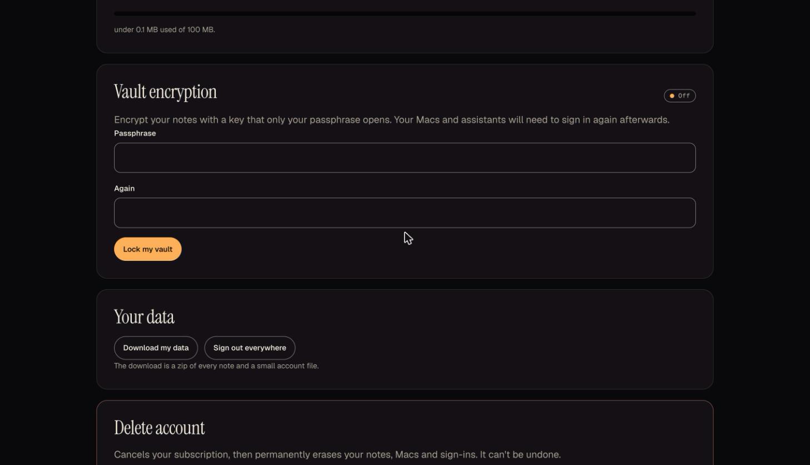
    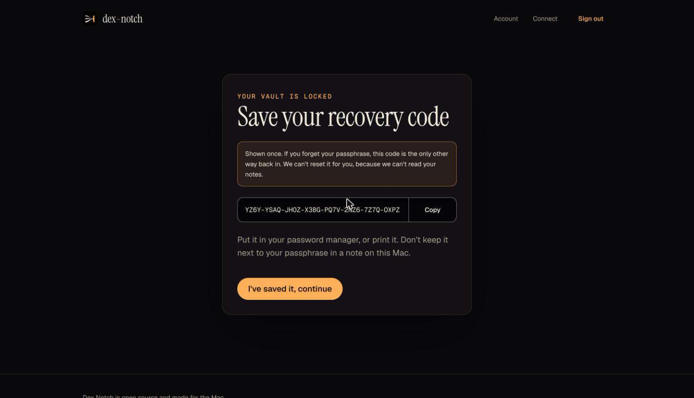
  

- **Sign in and unlock with Touch ID.** Add a passkey (Touch ID, your phone, or a security key) and one touch signs you in and opens your vault: no email link and no passphrase. Browsers that can will offer your passkey right in the email field, and tell your password manager when a passkey has been removed. Choosing a passkey when you set up your vault means there is no passphrase at all; your recovery code is the way back in. A passkey that can't open notes still signs you in, and the emailed link and the passphrase keep working. Exporting your notes always asks again, even when you are signed in with a passkey.

  

    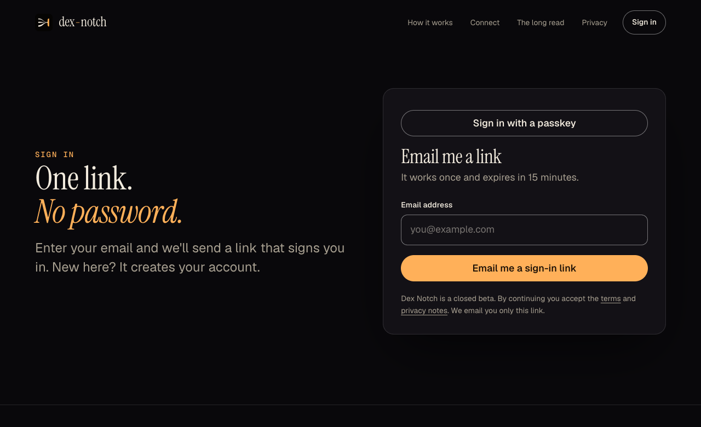
    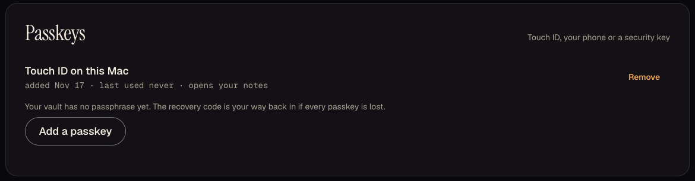
  

- **Macs and assistants linked before you lock your vault must be linked again.** Dex Notch notices and returns to its sign-in window on its next launch or hourly check. Claude and ChatGPT ask you to sign in once more, with your passphrase.
- **Dex Notch checks that your assistants are connected.** **Settings → Memory → Connections** shows whether your vault is locked and whether Claude, ChatGPT, Claude Code and Codex are connected, each with a button that takes you straight to the fix (**Lock my vault**, **Connect**, **Add to Claude Code**). It asks your account which web assistants are connected, and asks the `claude` and `codex` tools about the terminal ones. If something this Mac has is missing, the notch tells you once (not again for three days), and **Remind me at the notch** turns that off.
- **One button saves every conversation.** **Settings → Memory → Save every conversation** adds a short instruction to the global files that Claude Code, Codex and Gemini read, so they save a summary to your memory when a conversation ends. The first time, a copy of each original file is kept next to it. The same text is on the connect page for ChatGPT's custom instructions and Claude's preferences. An assistant decides for itself when a conversation is over, so you can always say "save this to my memory".
- **A page to connect every assistant.** The new **Connect** page on the website has the address to paste, and the steps for Claude, ChatGPT, Claude Code and Codex, with a status for the ones you have connected.

  

    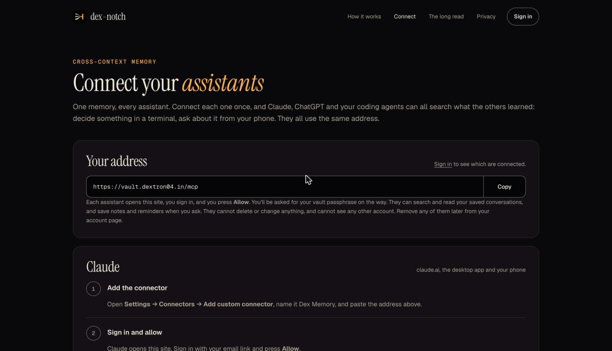
  

- **Privacy, terms and a long read, on the website.** The privacy notes and terms now open on the site instead of GitHub, and a new long read explains the problem Dex solves, how it can grow, and the plan for many people sharing one AI session.

  

    
  

  [Watch it as a video](docs/assets/gif-longread.mp4)

## v0.8.2: Closed beta, and a way to report problems

*17 November 2026*

- **Report a problem from Settings → Memory.** **Copy diagnostics** puts the setup facts on your clipboard: the version, macOS, what is switched on, whether Full Disk Access is granted, and when the server last confirmed this Mac. It never includes your email, passwords or conversations. **Report a problem** opens the issue form on GitHub; paste the diagnostics into it.
- **Dex Notch is in a closed beta.** Sign-in is by invitation. Ask for one on the waitlist at the Dex Notch website and you will get an email when there is room, then a welcome email once your account exists. The [terms](docs/terms.md) and [PRIVACY.md](PRIVACY.md) are published and linked from the sign-in page.
- **The hosted service is stricter.** It redirects plain `http://` to `https://`, tells browsers to only use https, and erases your waitlist entry and invitation when you delete your account.

## v0.8.1: A free plan, and clearer setup on the website

*16 November 2026*

- **Free accounts can use memory.** A free account now gets **100 MB** of memory: uploads from your Mac and the Claude/ChatGPT connector both work, with no payment. Paid plans (not open yet) will have more room. The Mac app itself is unchanged.
- **The account page says where you stand.** It shows your plan, how much of your space is used, and, for the owner account, that there is no limit.
- **Connecting Claude is spelled out.** Which menu to open, what to paste, who to sign in as, and what to do if you still have an older Dex connector. The steps for adding a Mac now describe the sign-in that Dex Notch opens by itself, instead of pasting a token.

## v0.8.0: Sign up, then start

*16 November 2026*

- **Dex Notch now starts with an account.** The first time you open it, a welcome window asks you to sign up or sign in. **Continue in browser** opens a page where you enter your email and get a link (no password); the page shows a short code, you check it matches the one on your Mac, and tap **Add this Mac**. Dex Notch starts once the server has confirmed it. An account is free while Dex Notch is in testing.
- **It checks every time you open it.** If you remove this Mac on your account page, or delete the account, Dex Notch goes back to the sign-in window. With no connection it keeps working for 7 days after the last time the server confirmed it, then waits until it can check again.
- **You choose whether conversations are uploaded.** The welcome window has a switch, **Keep my AI conversations in my account**, with what it means beside it. Change it later in Settings → Memory, where you can also **Sign out**. Notes are stored on the server operator's machine and are not end-to-end encrypted: [PRIVACY.md](PRIVACY.md) has the details.
- **Everyone signs in, including people already using Dex Notch.** Your notes and settings on this Mac are not touched.

## v0.7.1: A home for hosted memory

*16 November 2026*

- **The hosted memory service now has a proper website.** A home page with a live demo of the notch, a redesigned sign-in, and an account page that shows what is set up: your Macs, whether Claude or ChatGPT is connected, and how much space you are using. Everything is served from the service itself, with no outside fonts or trackers. The Mac app itself is unchanged.
- **Link previews work.** The service now answers the "headers only" requests that chat apps and link checkers send.

## v0.7.0: Hosted memory (optional)

*16 November 2026*

- **A new Memory pane in Settings.** If you have a Dex account on a hosted memory server, you can connect this Mac to it, and your recorded AI conversations are kept there so Claude and ChatGPT can search them from anywhere. It is optional and does nothing until you connect: nothing is uploaded unless you create an account, add this Mac, and paste its device token. Paid plans are not open yet, so for now this is for early testers.
- **You stay in control.** On your account page you can see your Macs, remove one (it stops uploading at once), sign out everywhere, **download all your data**, or **delete your account**, which erases your notes. Disconnecting in Settings → Memory stops uploads from this Mac. The first connection uploads your whole history; after that only new turns.
- **What it means for privacy.** Notes are stored on the server operator's machine and are not end-to-end encrypted, so don't upload anything you wouldn't trust the operator with. Passwords and API keys are stripped first, but that can't catch everything. [PRIVACY.md](PRIVACY.md) has the full details.

## v0.6.6: Urgent notifications always show

*15 November 2026*

- **Interview, OTP, deadline and similar notifications skip the AI and show at once.** A notification from an app that is on your Mac used to wait for the AI to judge it, and a notification the AI scored low never reached the notch. Now one that contains a word like *interview*, *offer letter*, *deadline*, *OTP*, *verification code*, *security alert*, *payment failed* or *meeting* is shown immediately. Change the list with `urgent_words` in the `addons` part of `settings.json`; an empty list turns this off.
- **A judge that failed tries again.** If no AI answered, the notifications waited for the next banner to arrive. Now they are retried about every minute.
- **The log says what happened to each notification.** For every banner, Console shows the app and where it went: iPhone card, shown at once, sent to the AI, muted or skipped (and why). It never logs the text. Filter on `in.dextron04.notch`, category `notes`.

## v0.6.5: iPhone notifications arrive instantly

*15 November 2026*

- **iPhone notifications show up the moment your Mac gets them.** Before, the notch looked for new ones every 5 seconds. Now it is woken as soon as one lands, so the card appears at once. The 5-second check stays as a backup.

## v0.6.4: Reminders stop nagging

*15 November 2026*

- **An ignored reminder comes back at most twice.** Before, a reminder you didn't press **Done** on returned every ten minutes for ever. Now it shows three times in all, ten minutes apart, and then leaves you alone. **Done** still clears it at once.
- **Old reminders stay quiet.** One that is more than a day overdue, such as after a long break, is dropped instead of popping up.

## v0.6.3: Long summaries fit, and reminders arrive instantly

*15 November 2026*

- **A long summary is no longer cut off.** In Recall, ⌘↩ on a session opens its summary under the list. The panel makes room for it, and if it is longer than the room there is, it scrolls instead of running off the bottom.
- **Reminders arrive the moment you set them.** A reminder you ask ChatGPT or Claude for now reaches your Mac within a second, instead of up to five minutes later, so it shows at the notch on time.

## v0.6.2: Reminders from your phone, and summaries that fit

*15 November 2026*

  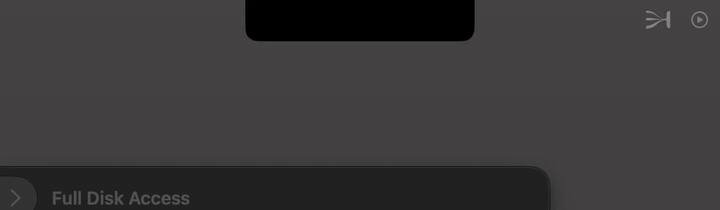

[Watch it as a video](docs/assets/reminder.mp4)

- **Ask ChatGPT to remind you, and the notch does.** Tell ChatGPT or Claude "remind me to call mum at 9 tomorrow" and the reminder shows up at your notch at that time, with **Done** (⌥↩) and **In 10 min** (⌥esc). If your Mac was asleep, it shows when you're back. Until you press Done it comes back every ten minutes. This needs the Dex vault connector, which now has a `remind` tool.
- **Summaries are no longer cut off.** In Recall, ⌘↩ on a session grows the panel just enough to show the whole summary, and scrolls if it is very long.

## v0.6.1: A faster, scrollable Activity page

*15 November 2026*

- **Activity no longer crawls on a big vault.** Moving between days used to reread every saved conversation on each key press. Dex Notch now remembers each note and only rereads the ones that changed, so it stays quick with thousands of sessions.
- **Every session on a day, not just three.** The day list under the Activity grid scrolls, and ↑↓ walks through all of them.
- **Bring in your ChatGPT history.** `agentvault import chatgpt` turns a ChatGPT data export (the unzipped folder, the .zip, or a single `conversations.json`) into notes in your vault. With no path it uses the newest export in Downloads. Secrets are redacted as they go in, and running it again never duplicates anything.

## v0.6.0: Updates at the notch, Mac notifications, and a plainer look

*15 November 2026*

  

- **New versions announce themselves.** When an update is out, the notch shows a card once: **What's new** (⌥N), **Update** or **Restart** (⌥↩), **Later** (⌥esc). ⌥N grows the card into a scrollable page with the notes for every release you haven't got yet, including their screenshots, animated gifs and videos.
- **Your Mac's notifications, judged.** Settings → iPhone has a new switch, off until you turn it on. Notifications from apps on this Mac, such as Slack or Messages, go to the same AI that reads your mail, and only the important ones become cards. This sends their text to the AI you picked, which is why it asks first.
- **iPhone notifications say when they can't work.** Without Full Disk Access they used to fail quietly. Now the notch shows a card, once a day, with a button that opens the right Privacy page. It goes away by itself when reading works, and failures are written to the system log.
- **No lag after sleep.** iPhone notifications are read the moment the Mac wakes or unlocks, instead of on the next five-second check.
- **A plainer look.** The notch, settings and replies now use the Mac's own sans-serif font instead of a serif. Every screenshot and clip in the README is retaken to match.
- **The model is named once.** Switching model no longer leaves three logos in the notch. The name appears briefly where you're looking, then goes away.
- Cards that aren't mail or phone cards, such as the update card, can no longer be muted with ⌥⌫.

## v0.5.0: Outlook and Microsoft 365 mail

*15 November 2026*

- **Connect Outlook.** Settings → Mail → **Connect Outlook** adds an Outlook.com, Hotmail or work or school Microsoft 365 mailbox. Its important mail reaches the notch like Gmail's does, with an Outlook mark and the account name when you have several.
- **Reply from Outlook mail too.** Reply, Send with Undo and Save draft work the same. A reply is sent from the original message, so Outlook threads it and quotes the original; Save draft puts it in your Outlook Drafts.
- **Read-only until you say so.** The same **Allow replies** switch decides whether the sign-in also asks Microsoft for permission to create drafts and send mail.
- **Mix accounts freely.** Gmail and Outlook accounts sit side by side in Settings, each with its own Remove link.
- **Nothing to set up.** Release builds carry their own Microsoft sign-in. Building from source, or want your own? Create a free application (steps in the README) and paste its ID in Settings → Mail → *Use your own Microsoft application*.
- Mail from IMAP or other providers is not supported yet.

## v0.4.0: Your iPhone's notifications, at the notch

*14 November 2026*

  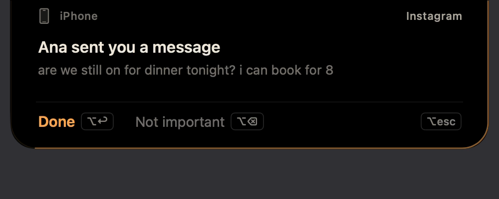

  

[Watch it as a video](docs/assets/phone-alert.mp4)

- **Notifications from your iPhone show at the notch.** They reach your Mac through iPhone Mirroring; Dex Notch picks them up and shows them like a mail alert: which app, who, and what they said. **Done** closes the card, **Not important** hides that app for good.
- **Off until you turn it on.** Settings → iPhone has the switch. It starts from the moment you turn it on and never shows old notifications.
- **It needs one Mac permission, and says why.** Your Mac keeps notifications in a private file that apps can't open unless you allow it. **Full Disk Access** lets Dex Notch open that one file. It only looks for new notifications, and nothing leaves your Mac. The settings page shows a green check as soon as you allow it.
- **A guided first launch.** A new install now walks you through everything in six short steps: the AI to ask, folders it may edit, Gmail, iPhone notifications, and a final summary. Every step explains in plain English why it needs what it asks for, and every step can be skipped. If you already had Dex Notch, you skip the walk-through and find the new iPhone page in Settings.
- **Good to know.** iPhone Mirroring must be set up, and System Settings → Notifications must allow notifications from your iPhone. Apple does not document where these are stored, so a future macOS update could break this; Settings then says so instead of failing quietly. An iPhone app that is also installed on your Mac is treated as the Mac's own and shows as usual.

## v0.3.2: Reply from the notch, and alerts that wait for you

*15 November 2026*

  

  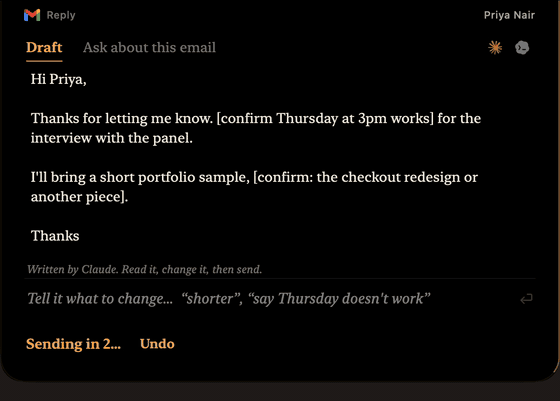

- **Nothing gets lost.** Alerts line up in the order the emails arrived, and the line is saved, so it survives a restart.
- **They wait until you are there.** If you have not touched the keyboard or mouse for two minutes, the alerts hold and show the moment you are back. If you walk away while a card is up, it goes back in the line instead of disappearing.
- **Reply from the notch.** **Reply** on a card (`⌥R`) grows it into a reply panel. An AI agent of your choice (Claude, Codex or your local model) drafts an answer you can edit directly or ask it to change ("make it shorter", "say Thursday doesn't work").
- **Ask about the email.** A second tab lets you ask what an email means or what it wants from you, without opening Gmail.
- **Sending is a small ceremony.** The edge of the panel is the clock: it drains over the five seconds you have to Undo, a comet circles it while the email goes out, then your draft folds into an envelope, a seal is pressed on, and the envelope flies out of the notch as a comet lights the edge again. (With Reduce Motion on, it just fades in sealed.)
- **Send or save, with a safety net.** **Send** waits five seconds so you can Undo; **Save draft** puts the reply in your Gmail drafts, in the same thread, to finish later. Replies thread correctly under the original.
- **The AI only writes the words.** Who it goes to and the subject come from the original email, a hostile email can't add recipients, and nothing leaves until you press Send.
- **Everyone signs in again once.** This version asks Google for a new permission, so every account connected before it has to be reconnected. Nothing is deleted: alerts for those accounts pause until you do. The next time you unlock your Mac, a card says "Reconnect Gmail to keep your alerts going" (**Reconnect** or **Later**, and it comes back daily until you have), the menu bar shows **Reconnect Gmail** and a dot, and Settings → Mail has a banner and a **Reconnect** link on each account.
- **One extra permission, and you stay in charge.** Connecting an account now also asks Google to let Dex Notch create drafts and send mail, and it only does either when you press Send or Save draft. Already connected? Settings → Mail shows which accounts can reply, with an **Allow replies** link on the rest. Prefer read-only? Turn **Allow replies** off and new accounts stay read-only. There is also a field for your name so replies are signed properly.
- **Opening the notch no longer throws a card away.** If you press `⌥ Space` to ask something while a card is up, the card steps aside and comes back after.
- **Lid closed?** With a monitor attached the Mac stays awake, and the alert appears in a notch-shaped pill at the top centre of that monitor. With no monitor the Mac sleeps, so nothing can show; your mail waits in Gmail and is read the moment you open the lid.
- **See what is waiting.** The menu shows **Show 3 waiting alerts** when some are queued, and **Settings → Mail → Recent alerts** keeps the last few you were shown, each with an **Open** link, in case you dismissed one by accident.

## v0.3.1: Updates tell you when they last looked

*15 November 2026*

- **Settings → Updates shows when Dex Notch last checked for a new version**, so you can see it is working without pressing anything.
- **What's new** now opens the notes for the version you are running, not the list of every release.
- This is the first version delivered by the new updater, which makes it the test of it.

## v0.3.0: Dex Notch updates itself

*15 November 2026*

- **No more trips to GitHub.** Once a day Dex Notch looks for a newer version and downloads it quietly in the background.
- **It always asks before restarting.** A small dot appears beside the menu bar mark, the menu offers **Restart to update**, and **Settings → Updates** has a **Restart now** link. If you just quit, the update installs on the way out.
- **It can't be tampered with.** Every update is signed, and the app refuses anything that was changed or not signed by this project.
- **Easy to turn off.** Settings → Updates has a switch, and **Check for Updates…** is in the menu bar.
- **Install this version by hand one last time.** Versions before it can't update themselves. From here on, updates arrive on their own.

## v0.2.1: Mail that comes to you

*15 November 2026*

  

**Dex Notch now watches your Gmail and tells you at the notch about the few emails that actually need you.** When you wake or unlock your Mac, the notch opens with two lines: what the email is, and why it matters. Everything else stays out of your way.

- **Two lines, one reason.** "Interview moved to Thursday 3:00 PM. A real person is waiting on your reply." No spam, no newsletters, no promotions.
- **Smart about what matters.** Promotions, social and forum mail are dropped first. An AI then judges what is left and only passes on what really needs you: a person waiting on you, a deadline, a meeting change, a failed payment, a delivery today. At most three at a time.
- **Tell it what you care about.** One line in Settings ("recruiters and my landlord") shapes what counts.
- **Claude first, then Codex, then your own model.** If one is out of messages or offline, the next takes over.
- **Several Gmail accounts.** Add as many as you like. The card says which one the mail came to, and **Open** goes to the right inbox.
- **New mail within minutes.** It looks every 5 minutes while your Mac is awake, and you can choose 2 minutes to 4 hours. Looking is light and free; the AI only reads mail that is new, waits a minute so a burst of mail becomes one reading, and is capped at 8 readings an hour so it never uses up your plan.
- **Three keys on the card.** `⌥↩` opens the email, `⌥⌫` says **Not important** (that sender is never shown again), `⌥esc` dismisses. They exist only while a card is on screen, so they never get in the way of typing.
- **Private by design.** Read-only access. Only the sender, subject and a short preview are read, never the message or attachments. The AI runs with no tools and leaves no record, and a hostile email can't make it do anything. See [PRIVACY.md](PRIVACY.md).

  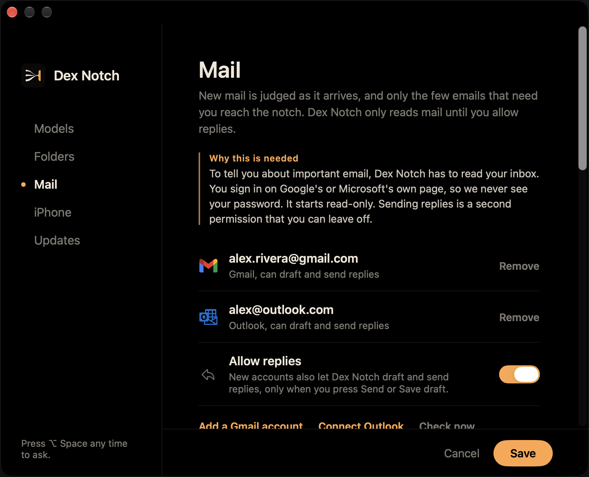

**A cleaner Settings window.** One page at a time (**Models**, **Folders**, **Mail**) instead of one long scroll, in the same black and ember as the notch.

  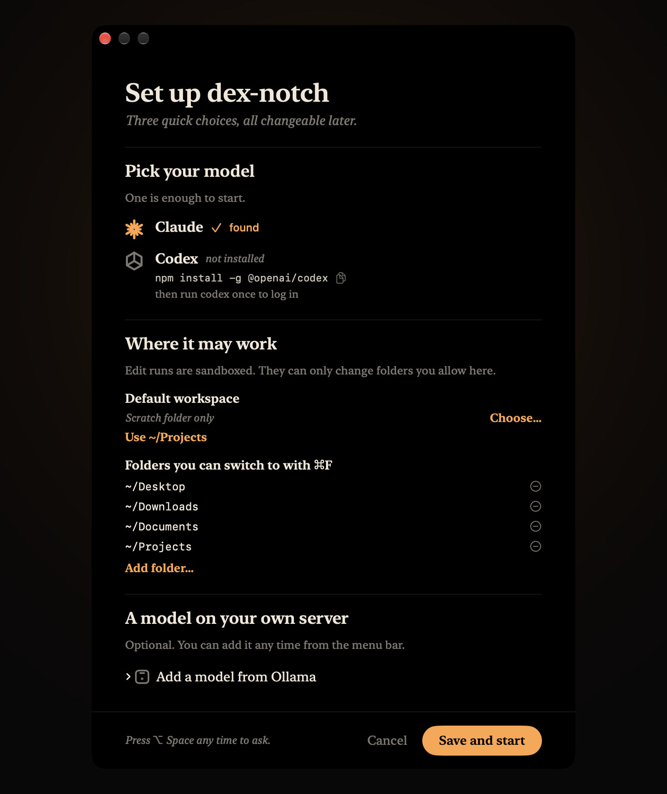

**A new name and a new look.** The app is now **Dex Notch**, with a new icon and a matching mark in the menu bar.

  

Also:

- The card's arrival is one smooth motion: the notch opens, a line of light runs round its edge, and that edge then drains over twelve seconds as the timer. Resting the pointer on the card holds it.
- The card now closes smoothly, folding back into the notch, instead of vanishing.
- Gmail's own error is shown when it says "slow down", instead of a guess.

**Coming from v0.1.0?** The app file is now `Dex Notch.app`, so delete the old `dex-notch.app` from Applications after you install this one. Your settings, chats and memory carry over.

*Version 0.2.0 was never published: its build failed on GitHub, so this release has its changes.*

## v0.1.0: The first release

*14 November 2026*

  

- **Press `⌥ Space` and the notch opens.** Ask Claude, Codex, or a model on your own server, with a dial to switch between them.
- **No API keys.** Claude and Codex run through their official command-line apps on your own subscriptions.
- **Recall** (`⌥⇧ Space`): your last chats, a heatmap of what you and your agents did, and your busiest projects.
- **One shared memory.** Every conversation with any AI lands in a searchable vault that all your agents can read, including ChatGPT and Claude.ai through an optional connector.
- **Sandboxed edits.** Claude and Codex can edit files only in folders you allow.
