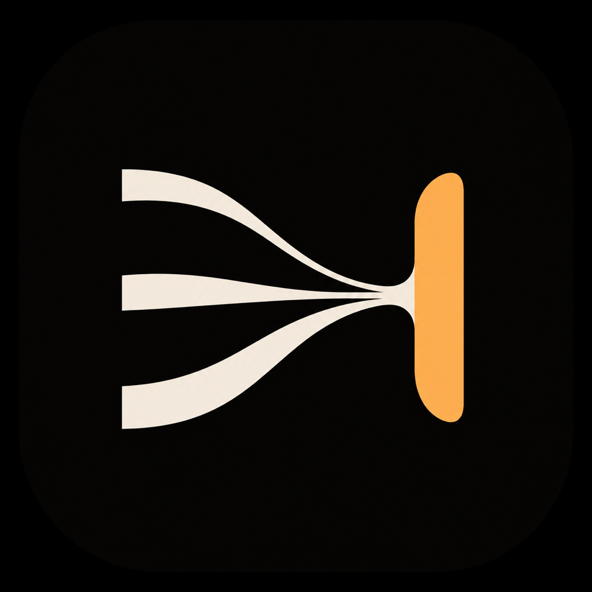
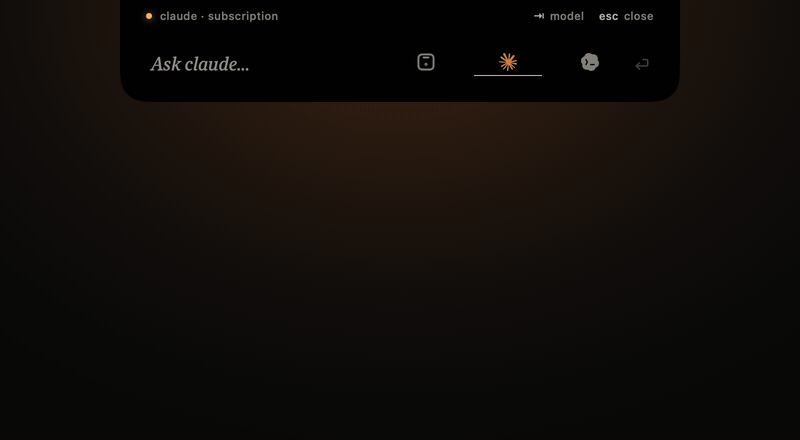

  

# What's new

The newest version is at the top. Every release is on the [Releases page](https://github.com/Dextron04/dex-notch/releases), where you can download it.

## v0.3.1: Updates tell you when they last looked

*15 November 2026*

- **Settings → Updates shows when Dex Notch last checked for a new version**, so you can see it is working without pressing anything.
- **What's new** now opens the notes for the version you are running, not the list of every release.
- This is the first version delivered by the new updater, which makes it the test of it.

## v0.3.0: Dex Notch updates itself

*15 November 2026*

- **No more trips to GitHub.** Once a day Dex Notch looks for a newer version and downloads it quietly in the background.
- **It always asks before restarting.** A small dot appears beside the menu bar mark, the menu offers **Restart to update**, and **Settings → Updates** has a **Restart now** link. If you just quit, the update installs on the way out.
- **It can't be tampered with.** Every update is signed, and the app refuses anything that was changed or not signed by this project.
- **Easy to turn off.** Settings → Updates has a switch, and **Check for Updates…** is in the menu bar.
- **Install this version by hand one last time.** Versions before it can't update themselves. From here on, updates arrive on their own.

## v0.2.1: Mail that comes to you

*15 November 2026*

  

**Dex Notch now watches your Gmail and tells you at the notch about the few emails that actually need you.** When you wake or unlock your Mac, the notch opens with two lines: what the email is, and why it matters. Everything else stays out of your way.

- **Two lines, one reason.** "Interview moved to Thursday 3:00 PM. A real person is waiting on your reply." No spam, no newsletters, no promotions.
- **Smart about what matters.** Promotions, social and forum mail are dropped first. An AI then judges what is left and only passes on what really needs you: a person waiting on you, a deadline, a meeting change, a failed payment, a delivery today. At most three at a time.
- **Tell it what you care about.** One line in Settings ("recruiters and my landlord") shapes what counts.
- **Claude first, then Codex, then your own model.** If one is out of messages or offline, the next takes over.
- **Several Gmail accounts.** Add as many as you like. The card says which one the mail came to, and **Open** goes to the right inbox.
- **New mail within minutes.** It looks every 5 minutes while your Mac is awake, and you can choose 2 minutes to 4 hours. Looking is light and free; the AI only reads mail that is new, waits a minute so a burst of mail becomes one reading, and is capped at 8 readings an hour so it never uses up your plan.
- **Three keys on the card.** `⌥↩` opens the email, `⌥⌫` says **Not important** (that sender is never shown again), `⌥esc` dismisses. They exist only while a card is on screen, so they never get in the way of typing.
- **Private by design.** Read-only access. Only the sender, subject and a short preview are read, never the message or attachments. The AI runs with no tools and leaves no record, and a hostile email can't make it do anything. See [PRIVACY.md](PRIVACY.md).

  

**A cleaner Settings window.** One page at a time (**Models**, **Folders**, **Mail**) instead of one long scroll, in the same black and ember as the notch.

  

**A new name and a new look.** The app is now **Dex Notch**, with a new icon and a matching mark in the menu bar.

  

Also:

- The card's arrival is one smooth motion: the notch opens, a line of light runs round its edge, and that edge then drains over twelve seconds as the timer. Resting the pointer on the card holds it.
- The card now closes smoothly, folding back into the notch, instead of vanishing.
- Gmail's own error is shown when it says "slow down", instead of a guess.

**Coming from v0.1.0?** The app file is now `Dex Notch.app`, so delete the old `dex-notch.app` from Applications after you install this one. Your settings, chats and memory carry over.

*Version 0.2.0 was never published: its build failed on GitHub, so this release has its changes.*

## v0.1.0: The first release

*14 November 2026*

  

- **Press `⌥ Space` and the notch opens.** Ask Claude, Codex, or a model on your own server, with a dial to switch between them.
- **No API keys.** Claude and Codex run through their official command-line apps on your own subscriptions.
- **Recall** (`⌥⇧ Space`): your last chats, a heatmap of what you and your agents did, and your busiest projects.
- **One shared memory.** Every conversation with any AI lands in a searchable vault that all your agents can read, including ChatGPT and Claude.ai through an optional connector.
- **Sandboxed edits.** Claude and Codex can edit files only in folders you allow.
