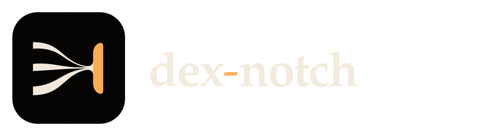
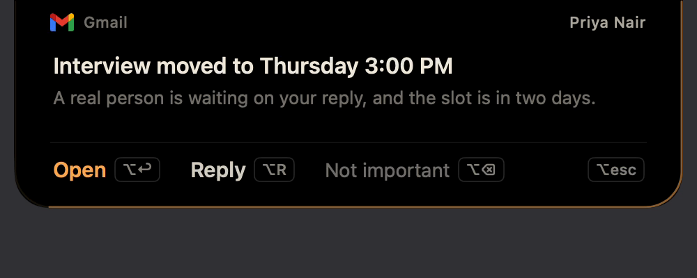
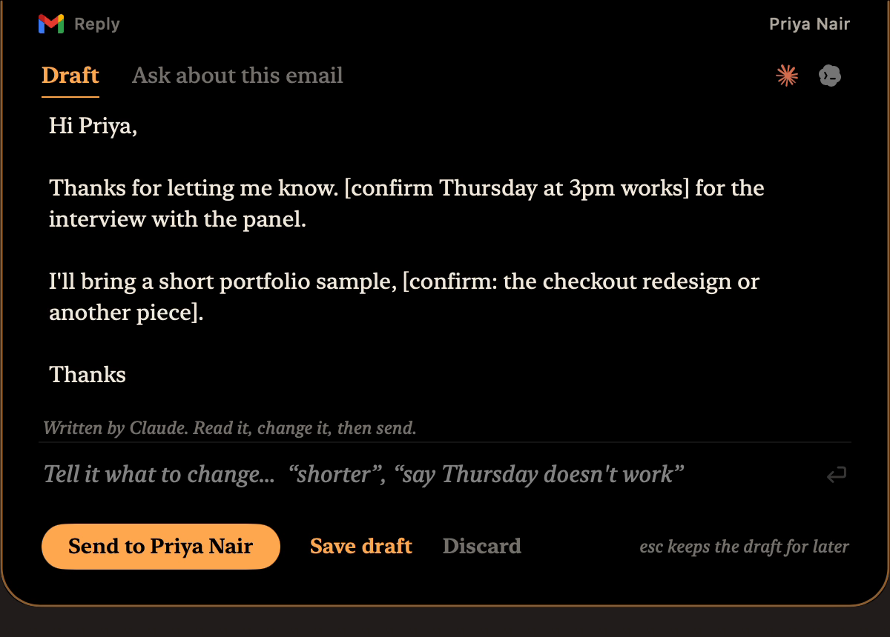

  

# What's new

The newest version is at the top. Every release is on the [Releases page](https://github.com/Dextron04/dex-notch/releases), where you can download it.

## v0.7.1: A home for hosted memory

*16 November 2026*

- **The hosted memory service now has a proper website.** A home page with a live demo of the notch, a redesigned sign-in, and an account page that shows what is set up: your Macs, whether Claude or ChatGPT is connected, and how much space you are using. Everything is served from the service itself, with no outside fonts or trackers. The Mac app itself is unchanged.
- **Link previews work.** The service now answers the "headers only" requests that chat apps and link checkers send.

## v0.7.0: Hosted memory (optional)

*16 November 2026*

- **A new Memory pane in Settings.** If you have a Dex account on a hosted memory server, you can connect this Mac to it, and your recorded AI conversations are kept there so Claude and ChatGPT can search them from anywhere. It is optional and does nothing until you connect: nothing is uploaded unless you create an account, add this Mac, and paste its device token. Paid plans are not open yet, so for now this is for early testers.
- **You stay in control.** On your account page you can see your Macs, remove one (it stops uploading at once), sign out everywhere, **download all your data**, or **delete your account**, which erases your notes. Disconnecting in Settings → Memory stops uploads from this Mac. The first connection uploads your whole history; after that only new turns.
- **What it means for privacy.** Notes are stored on the server operator's machine and are not end-to-end encrypted, so don't upload anything you wouldn't trust the operator with. Passwords and API keys are stripped first, but that can't catch everything. [PRIVACY.md](PRIVACY.md) has the full details.

## v0.6.6: Urgent notifications always show

*15 November 2026*

- **Interview, OTP, deadline and similar notifications skip the AI and show at once.** A notification from an app that is on your Mac used to wait for the AI to judge it, and a notification the AI scored low never reached the notch. Now one that contains a word like *interview*, *offer letter*, *deadline*, *OTP*, *verification code*, *security alert*, *payment failed* or *meeting* is shown immediately. Change the list with `urgent_words` in the `addons` part of `settings.json`; an empty list turns this off.
- **A judge that failed tries again.** If no AI answered, the notifications waited for the next banner to arrive. Now they are retried about every minute.
- **The log says what happened to each notification.** For every banner, Console shows the app and where it went: iPhone card, shown at once, sent to the AI, muted or skipped (and why). It never logs the text. Filter on `in.dextron04.notch`, category `notes`.

## v0.6.5: iPhone notifications arrive instantly

*15 November 2026*

- **iPhone notifications show up the moment your Mac gets them.** Before, the notch looked for new ones every 5 seconds. Now it is woken as soon as one lands, so the card appears at once. The 5-second check stays as a backup.

## v0.6.4: Reminders stop nagging

*15 November 2026*

- **An ignored reminder comes back at most twice.** Before, a reminder you didn't press **Done** on returned every ten minutes for ever. Now it shows three times in all, ten minutes apart, and then leaves you alone. **Done** still clears it at once.
- **Old reminders stay quiet.** One that is more than a day overdue, such as after a long break, is dropped instead of popping up.

## v0.6.3: Long summaries fit, and reminders arrive instantly

*15 November 2026*

- **A long summary is no longer cut off.** In Recall, ⌘↩ on a session opens its summary under the list. The panel makes room for it, and if it is longer than the room there is, it scrolls instead of running off the bottom.
- **Reminders arrive the moment you set them.** A reminder you ask ChatGPT or Claude for now reaches your Mac within a second, instead of up to five minutes later, so it shows at the notch on time.

## v0.6.2: Reminders from your phone, and summaries that fit

*15 November 2026*

  

[Watch it as a video](docs/assets/reminder.mp4)

- **Ask ChatGPT to remind you, and the notch does.** Tell ChatGPT or Claude "remind me to call mum at 9 tomorrow" and the reminder shows up at your notch at that time, with **Done** (⌥↩) and **In 10 min** (⌥esc). If your Mac was asleep, it shows when you're back. Until you press Done it comes back every ten minutes. This needs the Dex vault connector, which now has a `remind` tool.
- **Summaries are no longer cut off.** In Recall, ⌘↩ on a session grows the panel just enough to show the whole summary, and scrolls if it is very long.

## v0.6.1: A faster, scrollable Activity page

*15 November 2026*

- **Activity no longer crawls on a big vault.** Moving between days used to reread every saved conversation on each key press. Dex Notch now remembers each note and only rereads the ones that changed, so it stays quick with thousands of sessions.
- **Every session on a day, not just three.** The day list under the Activity grid scrolls, and ↑↓ walks through all of them.
- **Bring in your ChatGPT history.** `agentvault import chatgpt` turns a ChatGPT data export (the unzipped folder, the .zip, or a single `conversations.json`) into notes in your vault. With no path it uses the newest export in Downloads. Secrets are redacted as they go in, and running it again never duplicates anything.

## v0.6.0: Updates at the notch, Mac notifications, and a plainer look

*15 November 2026*

  

- **New versions announce themselves.** When an update is out, the notch shows a card once: **What's new** (⌥N), **Update** or **Restart** (⌥↩), **Later** (⌥esc). ⌥N grows the card into a scrollable page with the notes for every release you haven't got yet, including their screenshots, animated gifs and videos.
- **Your Mac's notifications, judged.** Settings → iPhone has a new switch, off until you turn it on. Notifications from apps on this Mac, such as Slack or Messages, go to the same AI that reads your mail, and only the important ones become cards. This sends their text to the AI you picked, which is why it asks first.
- **iPhone notifications say when they can't work.** Without Full Disk Access they used to fail quietly. Now the notch shows a card, once a day, with a button that opens the right Privacy page. It goes away by itself when reading works, and failures are written to the system log.
- **No lag after sleep.** iPhone notifications are read the moment the Mac wakes or unlocks, instead of on the next five-second check.
- **A plainer look.** The notch, settings and replies now use the Mac's own sans-serif font instead of a serif. Every screenshot and clip in the README is retaken to match.
- **The model is named once.** Switching model no longer leaves three logos in the notch. The name appears briefly where you're looking, then goes away.
- Cards that aren't mail or phone cards, such as the update card, can no longer be muted with ⌥⌫.

## v0.5.0: Outlook and Microsoft 365 mail

*15 November 2026*

- **Connect Outlook.** Settings → Mail → **Connect Outlook** adds an Outlook.com, Hotmail or work or school Microsoft 365 mailbox. Its important mail reaches the notch like Gmail's does, with an Outlook mark and the account name when you have several.
- **Reply from Outlook mail too.** Reply, Send with Undo and Save draft work the same. A reply is sent from the original message, so Outlook threads it and quotes the original; Save draft puts it in your Outlook Drafts.
- **Read-only until you say so.** The same **Allow replies** switch decides whether the sign-in also asks Microsoft for permission to create drafts and send mail.
- **Mix accounts freely.** Gmail and Outlook accounts sit side by side in Settings, each with its own Remove link.
- **Nothing to set up.** Release builds carry their own Microsoft sign-in. Building from source, or want your own? Create a free application (steps in the README) and paste its ID in Settings → Mail → *Use your own Microsoft application*.
- Mail from IMAP or other providers is not supported yet.

## v0.4.0: Your iPhone's notifications, at the notch

*14 November 2026*

  

  

[Watch it as a video](docs/assets/phone-alert.mp4)

- **Notifications from your iPhone show at the notch.** They reach your Mac through iPhone Mirroring; Dex Notch picks them up and shows them like a mail alert: which app, who, and what they said. **Done** closes the card, **Not important** hides that app for good.
- **Off until you turn it on.** Settings → iPhone has the switch. It starts from the moment you turn it on and never shows old notifications.
- **It needs one Mac permission, and says why.** Your Mac keeps notifications in a private file that apps can't open unless you allow it. **Full Disk Access** lets Dex Notch open that one file. It only looks for new notifications, and nothing leaves your Mac. The settings page shows a green check as soon as you allow it.
- **A guided first launch.** A new install now walks you through everything in six short steps: the AI to ask, folders it may edit, Gmail, iPhone notifications, and a final summary. Every step explains in plain English why it needs what it asks for, and every step can be skipped. If you already had Dex Notch, you skip the walk-through and find the new iPhone page in Settings.
- **Good to know.** iPhone Mirroring must be set up, and System Settings → Notifications must allow notifications from your iPhone. Apple does not document where these are stored, so a future macOS update could break this; Settings then says so instead of failing quietly. An iPhone app that is also installed on your Mac is treated as the Mac's own and shows as usual.

## v0.3.2: Reply from the notch, and alerts that wait for you

*15 November 2026*

  

  

- **Nothing gets lost.** Alerts line up in the order the emails arrived, and the line is saved, so it survives a restart.
- **They wait until you are there.** If you have not touched the keyboard or mouse for two minutes, the alerts hold and show the moment you are back. If you walk away while a card is up, it goes back in the line instead of disappearing.
- **Reply from the notch.** **Reply** on a card (`⌥R`) grows it into a reply panel. An AI agent of your choice (Claude, Codex or your local model) drafts an answer you can edit directly or ask it to change ("make it shorter", "say Thursday doesn't work").
- **Ask about the email.** A second tab lets you ask what an email means or what it wants from you, without opening Gmail.
- **Sending is a small ceremony.** The edge of the panel is the clock: it drains over the five seconds you have to Undo, a comet circles it while the email goes out, then your draft folds into an envelope, a seal is pressed on, and the envelope flies out of the notch as a comet lights the edge again. (With Reduce Motion on, it just fades in sealed.)
- **Send or save, with a safety net.** **Send** waits five seconds so you can Undo; **Save draft** puts the reply in your Gmail drafts, in the same thread, to finish later. Replies thread correctly under the original.
- **The AI only writes the words.** Who it goes to and the subject come from the original email, a hostile email can't add recipients, and nothing leaves until you press Send.
- **Everyone signs in again once.** This version asks Google for a new permission, so every account connected before it has to be reconnected. Nothing is deleted: alerts for those accounts pause until you do. The next time you unlock your Mac, a card says "Reconnect Gmail to keep your alerts going" (**Reconnect** or **Later**, and it comes back daily until you have), the menu bar shows **Reconnect Gmail** and a dot, and Settings → Mail has a banner and a **Reconnect** link on each account.
- **One extra permission, and you stay in charge.** Connecting an account now also asks Google to let Dex Notch create drafts and send mail, and it only does either when you press Send or Save draft. Already connected? Settings → Mail shows which accounts can reply, with an **Allow replies** link on the rest. Prefer read-only? Turn **Allow replies** off and new accounts stay read-only. There is also a field for your name so replies are signed properly.
- **Opening the notch no longer throws a card away.** If you press `⌥ Space` to ask something while a card is up, the card steps aside and comes back after.
- **Lid closed?** With a monitor attached the Mac stays awake, and the alert appears in a notch-shaped pill at the top centre of that monitor. With no monitor the Mac sleeps, so nothing can show; your mail waits in Gmail and is read the moment you open the lid.
- **See what is waiting.** The menu shows **Show 3 waiting alerts** when some are queued, and **Settings → Mail → Recent alerts** keeps the last few you were shown, each with an **Open** link, in case you dismissed one by accident.

## v0.3.1: Updates tell you when they last looked

*15 November 2026*

- **Settings → Updates shows when Dex Notch last checked for a new version**, so you can see it is working without pressing anything.
- **What's new** now opens the notes for the version you are running, not the list of every release.
- This is the first version delivered by the new updater, which makes it the test of it.

## v0.3.0: Dex Notch updates itself

*15 November 2026*

- **No more trips to GitHub.** Once a day Dex Notch looks for a newer version and downloads it quietly in the background.
- **It always asks before restarting.** A small dot appears beside the menu bar mark, the menu offers **Restart to update**, and **Settings → Updates** has a **Restart now** link. If you just quit, the update installs on the way out.
- **It can't be tampered with.** Every update is signed, and the app refuses anything that was changed or not signed by this project.
- **Easy to turn off.** Settings → Updates has a switch, and **Check for Updates…** is in the menu bar.
- **Install this version by hand one last time.** Versions before it can't update themselves. From here on, updates arrive on their own.

## v0.2.1: Mail that comes to you

*15 November 2026*

  

**Dex Notch now watches your Gmail and tells you at the notch about the few emails that actually need you.** When you wake or unlock your Mac, the notch opens with two lines: what the email is, and why it matters. Everything else stays out of your way.

- **Two lines, one reason.** "Interview moved to Thursday 3:00 PM. A real person is waiting on your reply." No spam, no newsletters, no promotions.
- **Smart about what matters.** Promotions, social and forum mail are dropped first. An AI then judges what is left and only passes on what really needs you: a person waiting on you, a deadline, a meeting change, a failed payment, a delivery today. At most three at a time.
- **Tell it what you care about.** One line in Settings ("recruiters and my landlord") shapes what counts.
- **Claude first, then Codex, then your own model.** If one is out of messages or offline, the next takes over.
- **Several Gmail accounts.** Add as many as you like. The card says which one the mail came to, and **Open** goes to the right inbox.
- **New mail within minutes.** It looks every 5 minutes while your Mac is awake, and you can choose 2 minutes to 4 hours. Looking is light and free; the AI only reads mail that is new, waits a minute so a burst of mail becomes one reading, and is capped at 8 readings an hour so it never uses up your plan.
- **Three keys on the card.** `⌥↩` opens the email, `⌥⌫` says **Not important** (that sender is never shown again), `⌥esc` dismisses. They exist only while a card is on screen, so they never get in the way of typing.
- **Private by design.** Read-only access. Only the sender, subject and a short preview are read, never the message or attachments. The AI runs with no tools and leaves no record, and a hostile email can't make it do anything. See [PRIVACY.md](PRIVACY.md).

  

**A cleaner Settings window.** One page at a time (**Models**, **Folders**, **Mail**) instead of one long scroll, in the same black and ember as the notch.

  

**A new name and a new look.** The app is now **Dex Notch**, with a new icon and a matching mark in the menu bar.

  

Also:

- The card's arrival is one smooth motion: the notch opens, a line of light runs round its edge, and that edge then drains over twelve seconds as the timer. Resting the pointer on the card holds it.
- The card now closes smoothly, folding back into the notch, instead of vanishing.
- Gmail's own error is shown when it says "slow down", instead of a guess.

**Coming from v0.1.0?** The app file is now `Dex Notch.app`, so delete the old `dex-notch.app` from Applications after you install this one. Your settings, chats and memory carry over.

*Version 0.2.0 was never published: its build failed on GitHub, so this release has its changes.*

## v0.1.0: The first release

*14 November 2026*

  

- **Press `⌥ Space` and the notch opens.** Ask Claude, Codex, or a model on your own server, with a dial to switch between them.
- **No API keys.** Claude and Codex run through their official command-line apps on your own subscriptions.
- **Recall** (`⌥⇧ Space`): your last chats, a heatmap of what you and your agents did, and your busiest projects.
- **One shared memory.** Every conversation with any AI lands in a searchable vault that all your agents can read, including ChatGPT and Claude.ai through an optional connector.
- **Sandboxed edits.** Claude and Codex can edit files only in folders you allow.
