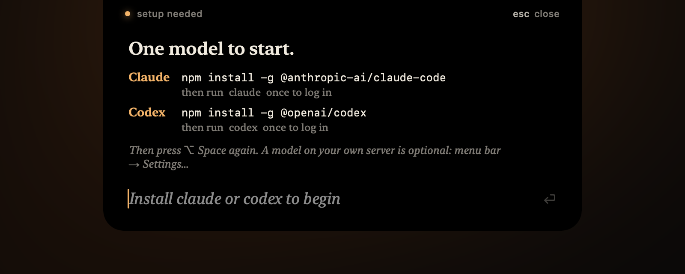
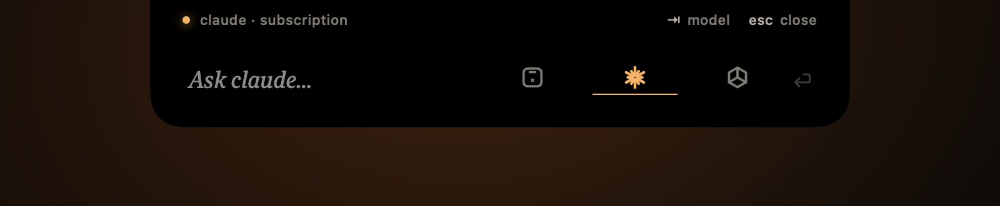
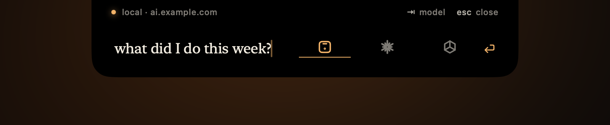
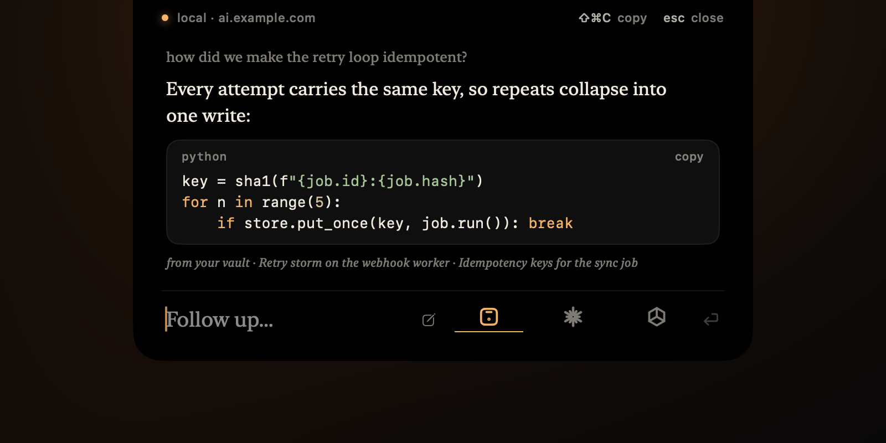
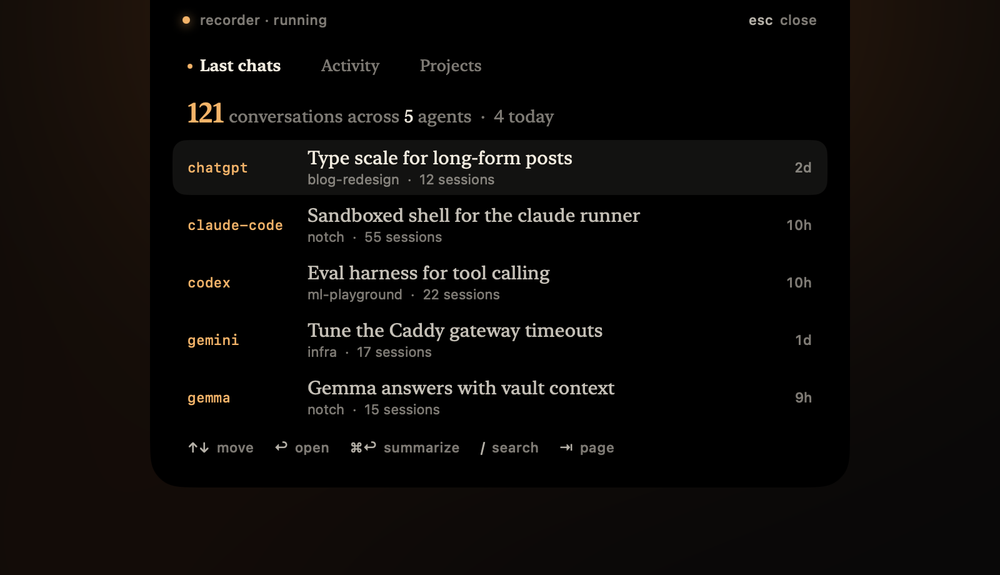

<p align="center">
  
</p>

<p align="center">
  
  
  
  
  
  
</p>

<p align="center">
  <b>Press a key. The notch opens. Ask Claude, Codex or a model on your own server, and every conversation you have with any AI lands in one searchable memory they can all read.</b>
</p>

<p align="center">
  
</p>

---

## No API keys. Your regular subscriptions.

dex-notch never asks for an OpenAI or Anthropic API key and never bills you per token.

| Model | What runs it | What it uses |
|---|---|---|
| **Claude** | the official `claude` CLI, launched headless | your **Claude subscription** login |
| **Codex** | the official `codex` CLI, launched headless | your **ChatGPT subscription** login |
| **Local model** (optional) | a model on your own machine, through Ollama | your own hardware. The only credential is a token for *your* server |

The app does not read, copy or reuse your login tokens. It starts the same CLIs you already use in a terminal, so usage counts against your normal plan limits. If you can run `claude` or `codex` in a terminal, the notch can use it. One of them is enough.

---

## Get started in two minutes

1. **Download** the latest `dex-notch-*.dmg` from [Releases](https://github.com/Dextron04/dex-notch/releases/latest) and drag **dex-notch** into Applications.
2. **Open it once with a right-click → Open.** The build is not notarized (that needs a paid Apple Developer ID), so macOS asks once. If it still refuses, run `xattr -dr com.apple.quarantine /Applications/dex-notch.app`.
3. **Answer three questions** in the setup window that opens by itself: which model, where it may work, and (optionally) a model on your own server.
4. **Press `⌥ Space`.**

<p align="center">
  
  <br><sub><b>First run.</b> It finds Claude and Codex for you and shows the exact install command for whatever is missing. Everything here is changeable later from the menu bar (<code>⌘ ,</code>).</sub>
</p>

Don't have `claude` or `codex` yet? The notch tells you what to install and waits:

<p align="center">
  
</p>

| Want | Add |
|---|---|
| **Just ask Claude or Codex from a hotkey** | nothing else. That is the DMG. |
| **A shared memory across all your agents** | the recorder: `cd memory && sh install.sh` ([below](#shared-memory-the-recorder)) |
| **A model on your own server** | Menu bar → **Settings…** → *A model on your own server*, or [edit `settings.json`](#settings) |
| **ChatGPT and Claude.ai reading your memory** | the [remote connector](#for-chatgpt-and-claudeai) |

---

## Every view

### Ask

<table>
  <tr>
    <td width="50%"></td>
    <td width="50%"></td>
  </tr>
  <tr>
    <td align="center"><sub><b>The dial.</b> Three logos, one amber underline. <code>⇥</code> or <code>⌘1</code> <code>⌘2</code> <code>⌘3</code> to switch, or click.</sub></td>
    <td align="center"><sub><b>Typing.</b> The send arrow lights up. The left wing names the model and what it can do.</sub></td>
  </tr>
  <tr>
    <td width="50%"></td>
    <td width="50%"></td>
  </tr>
  <tr>
    <td align="center"><sub><b>Edit rights.</b> <code>⌘E</code> adds a <b>+</b>: it may edit files and run sandboxed commands. <code>⌘F</code> picks the folder.</sub></td>
    <td align="center"><sub><b>Your own model.</b> The custom mark is the notch cut into a rounded square. The wing shows your host.</sub></td>
  </tr>
</table>

<p align="center">
  
  <br><sub><b>Answers with receipts.</b> Code gets its own block with a copy button. When the local model drew on your memory it names the notes.</sub>
</p>

### Recall

Press `⌥⇧ Space` to see what you and your agents have been doing.

<table>
  <tr>
    <td width="50%"></td>
    <td width="50%"></td>
  </tr>
  <tr>
    <td align="center"><sub><b>Last chats.</b> Where you left off with every agent. <code>↩</code> opens the note in Obsidian, <code>⌘↩</code> summarizes it.</sub></td>
    <td align="center"><sub><b>Activity.</b> Ten weeks, per agent. <code>←</code> <code>→</code> move the day.</sub></td>
  </tr>
</table>

<p align="center">
  
  <br><sub><b>Projects.</b> Where the conversation actually went.</sub>
</p>

<sub>Screenshots use a synthetic vault and demo settings (`scripts/demo_vault.py`), not real conversations. The three model marks are simplified original drawings, not the brands' official logos.</sub>

---

## The problems this solves

| The problem | What dex-notch does about it |
|---|---|
| **Every AI is an island.** What you decided with Claude Code is invisible to Codex, Gemini and ChatGPT. | A recorder turns every session into a redacted markdown note in one Obsidian vault. Every agent can search it. |
| **Setup that takes an afternoon.** | A DMG and one window. It finds your CLIs, tells you the install command for what's missing, and asks where edit runs may write. |
| **Switching model means retyping `@names`.** | A three-logo dial: `⇥`, `⌘1/2/3`, or a click. Typing `@claude ` still works and snaps onto the dial. |
| **A local model that makes things up about your own work.** | Before each local-model answer the notch searches your vault, hands the model the best snippets, and names the notes it used. |
| **"Can it run code?" without giving a model your machine.** | `+` turns on edit rights *and* a shell, inside an OS sandbox: no network, and writes only to a scratch folder plus the folders you chose. |
| **Click away, lose the chat.** | The conversation survives closing the notch, quitting and restarting. It starts fresh after 30 idle minutes or on `⌘N`. |
| **Transcripts are full of secrets.** | Redaction runs before anything is written: provider keys, bearer tokens, URL credentials, `password=`-style assignments. |
| **ChatGPT and Claude.ai can't see any of it.** | A remote MCP connector with real OAuth gives their web and phone apps read access, plus a `remember` tool to save a chat on request. |
| **You can't see your own AI habits.** | The recall view: last chats, a per-agent heatmap, and a projects ranking. |
| **Paying twice for the same models.** | No API keys. It rides the subscriptions you already have. |

---

## How it works

<p align="center">
  
</p>

1. **Capture.** A launchd agent polls each tool's own log every 30 seconds, resuming from a byte offset and ignoring half-written lines. Adapters exist for Claude Code, Codex, Gemini/Antigravity and the notch's own local-model chats.
2. **Redact, then write.** Secrets are stripped before text reaches disk. Notes are idempotent: every section carries a hash marker, so crashes, restarts and duplicate session copies never create duplicates.
3. **One vault.** Plain markdown under `Sessions/<agent>/<month>/`, with generated `Index`, `Agents`, `Projects` and `Days` hub notes so Obsidian's graph view clusters your work.
4. **Read it anywhere.** The notch recall view; an MCP server (`vault_search`, `vault_recent`, `vault_read`) for Claude Code, Codex and Gemini; a start-up digest so Claude Code opens already briefed; a semantic RAG index; and a remote connector for ChatGPT and Claude.ai.

**The notch itself** is a borderless, non-activating panel pinned to the top centre of the notched display. It never resizes, because a content-driven resize drifts the window off-centre. The SwiftUI pill animates inside it. On a Mac without a notch it draws a notch-sized pill at the top centre of the screen.

---

## Keys

**Ask** (`⌥ Space`)

| Key | Action |
|---|---|
| `↩` | send |
| `⇥` / `⇧⇥` | next / previous model |
| `⌘1` `⌘2` `⌘3` | the 1st, 2nd, 3rd model on the dial |
| `⌘E` | allow edits and sandboxed commands (Claude, Codex) |
| `⌘F` | cycle the folder edit runs may write to (your scratch sandbox, then each folder you allowed) |
| `⌘N` | new conversation |
| `⇧⌘C` | copy the answer |
| `esc` | close. The chat stays. |

**Recall** (`⌥⇧ Space`)

| Key | Action |
|---|---|
| `⇥` or `←` `→` | switch page. On Activity, `←` `→` move the day |
| `↑` `↓` | move through sessions |
| `↩` | open the note in Obsidian |
| `⌘↩` | three-line summary from the model |
| `/` | search titles, projects and agents |

**Menu bar:** **Settings…** (`⌘ ,`), Recall, Check connection, Quit.

---

## Settings

The setup window writes `~/Library/Application Support/NotchApp/settings.json`. You can also edit it by hand. Every key is optional, unknown keys are kept, and the file is re-read whenever you press `⌥ Space` or **Check connection**.

```json
{
  "default": "claude",
  "workspace": {
    "default": "~/Projects",
    "folders": ["~/Desktop", "~/Downloads", "~/Projects"]
  },
  "gemma": {
    "host": "ai.example.com",
    "model": "gemma3:12b"
  }
}
```

| Key | Meaning |
|---|---|
| `default` | `"claude"`, `"codex"` or `"gemma"` (the local model). Which one starts selected. Ignored if that model isn't available. |
| `workspace.default` | The folder edit runs may write to by default. Leave it out to use only the scratch folder. |
| `workspace.folders` | The folders `⌘F` cycles through. Leave it out for Desktop, Downloads, Documents and Projects. |
| `gemma.host` | Your Ollama server's hostname (HTTPS only). A pasted `https://…/` is tidied. |
| `gemma.model` | The model name your server knows (`ollama list`). There is no default. |
| `gemma.keychain_service` / `keychain_account` | Where the token lives in your Keychain. Default: the host, and `notchapp`. |

**Folder rules.** A folder must exist, sit *inside* your home folder, and not be your home folder itself, a hidden top-level folder (`~/.ssh`, `~/.aws`, …) or `~/Library`. `..` and symlinks can't be used to escape. Rejected entries are reported and ignored; the rest still apply.

### Add a local model later

Skip it on day one and add it whenever you like:

1. Run [Ollama](https://ollama.com) somewhere you control and put it behind HTTPS with a bearer token (Caddy and a Cloudflare tunnel work well).
2. Menu bar → **Settings…** → open *A model on your own server*, fill in the host, the model name and the token, and **Save and start**. The token goes into your Keychain, never into `settings.json`.
3. A third logo appears on the dial.

Without it everything else works, and the dial simply has two models.

---

## Safety model

| | Local model | Claude (`@claude`) | Codex (`@codex`) |
|---|---|---|---|
| **Ask (default)** | no tools; vault snippets only | read, search, web, vault tools. **No shell, no edits.** | read-only sandbox |
| **Edit + run (`+`)** | not available | edits, plus a shell in Claude Code's OS sandbox | `workspace-write` sandbox |
| **Where it can write** | nowhere | the scratch folder, plus the one folder you selected | the scratch folder, plus the one folder you selected |
| **Network from commands** | n/a | blocked | blocked |

- Edit runs cannot fall back to an unsandboxed shell.
- Only folders you allowed can be granted, one at a time, and each is re-checked right before a run.
- Private files (saved conversation, the local model's journal, OAuth state) are mode `600`. The token lives in the Keychain.
- The remote connector uses OAuth 2.1 with PKCE (S256 only), a redirect-host allow-list, hashed token storage, and a per-client lockout after five wrong passphrases.

---

## Shared memory (the recorder)

The app works on its own. To make your agents remember each other, install the recorder, which is Python standard library only:

```bash
git clone https://github.com/Dextron04/dex-notch && cd dex-notch/memory
sh install.sh                      # records into ~/Vault every 30 s
python3 -m agentvault backfill     # one-time import of your existing history
```

Let your agents read the vault:

```bash
claude mcp add agentvault -e PYTHONPATH=/path/to/dex-notch/memory -- python3 -m agentvault.mcp_server --vault ~/Vault
```

```toml
# ~/.codex/config.toml
[mcp_servers.agentvault]
command = "python3"
args = ["-m", "agentvault.mcp_server", "--vault", "/Users/you/Vault"]
env = { PYTHONPATH = "/path/to/dex-notch/memory" }
```

If you added a local model, the recorder also indexes your vault on that server for semantic search. It reads the same `settings.json`. The first sync asks once for access to the token in your Keychain; choose **Always Allow**.

### For ChatGPT and Claude.ai

Run the connector on an always-on machine behind a tunnel, then add its URL as a custom connector in either app:

```bash
python3 -m agentvault.remote --vault ~/agentvault/Vault --state ~/agentvault/oauth.json \
  --passphrase-file ~/agentvault/passphrase --public-url https://memory.example.com
REMOTE=host:agentvault/Vault sh install.sh   # keeps both vault copies in step
```

---

## Honest limits

- **The DMG is not notarized.** The first launch needs a right-click → Open. Notarizing takes a paid Apple Developer ID.
- **Memory is a separate install for now.** The recorder and MCP server live in `memory/` and aren't bundled in the app yet. Without them the recall view is empty and the local model has no vault to search.
- **ChatGPT and Claude.ai chats are not captured live.** Neither exposes chat history to apps, and MCP is pull-only. The connector lets them *read* your vault and *save* a chat when you ask. A full import from the official data export is not built yet.
- **The local model is a chat model with retrieved snippets, not an agent.** It cannot open a note or run tools.
- **The vault is plain text.** Redaction is pattern-based. Treat the vault like any other folder of your private conversations.
- **Edit runs are powerful.** An edit run with Desktop allowed can rearrange it, with no confirmation prompt. Ask for a plan first if it matters.

---

## Build from source

**Requirements:** macOS 14+, Xcode 16 (Swift 6), [XcodeGen](https://github.com/yonaskolb/XcodeGen).

```bash
brew install xcodegen
xcodegen generate
xcodebuild -scheme NotchApp -configuration Debug build   # or open NotchApp.xcodeproj
scripts/make-dmg.sh v0.1.0                               # a universal, ad-hoc signed DMG and zip in build/dist/
```

Releases are built by GitHub Actions: push a tag (`git tag v0.1.0 && git push --tags`) and a DMG is attached to a new release. CI runs every test on each push.

**Demo mode.** `NOTCH_VAULT`, `NOTCH_SETTINGS` and `NOTCH_CLIS` (for example `none`, or `claude,codex`) point the app at other data or pretend which CLIs are installed. That is how the screenshots here were made, and how to rehearse the first run:

```bash
python3 scripts/demo_vault.py /tmp/demo-vault
NOTCH_VAULT=/tmp/demo-vault NOTCH_SETTINGS=/tmp/none.json NOTCH_CLIS=none open path/to/dex-notch.app
```

### Project layout

```
NotchApp/                 SwiftUI + AppKit menu-bar agent
  NotchWindow.swift         the fixed-size panel and key handling
  NotchView.swift           pill, wings, model dial, transcript, setup card
  ModelMark.swift           the three vector logos
  SetupView.swift           first-run and settings window
  Assistant.swift           state, local-model streaming, vault recall, persistence
  AgentStream.swift         routing, CLI arguments, stream parsing (pure, tested)
  AgentRunner.swift         launches claude / codex headless
  Settings.swift            settings.json: models, workspace, folder rules (pure, tested)
  RecallView.swift          chats, heatmap, projects
  VaultReader.swift         reads the vault the recorder writes
memory/
  agentvault/               recorder, adapters, redaction, MCP server, RAG push
    remote/                 OAuth + MCP over HTTP for ChatGPT and Claude.ai
  hooks/                    Claude Code start-up digest
  tests/                    117 tests
NotchAppTests/             133 tests
scripts/                   make-dmg.sh, demo_vault.py
.github/workflows/         CI and release
docs/                      specs, plans, example settings, assets
```

```bash
xcodebuild test -scheme NotchApp -destination 'platform=macOS'   # 133 Swift tests
cd memory && python3 -m unittest discover -s tests               # 117 Python tests
```

Everything here was built test-first where it could be: the stream parsers, the sandbox arguments, the folder rules, the OAuth flow, the lockout, the redaction rules, the idempotent note writer.

## License

[MIT](LICENSE). Use it, change it, ship it.
