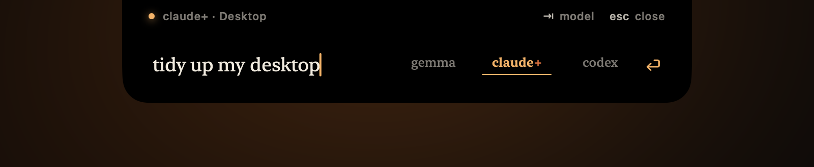
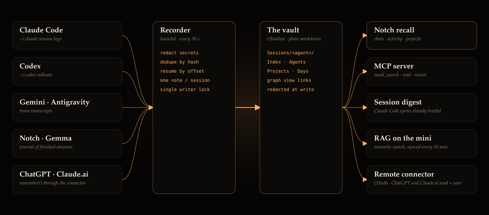

<p align="center">
  
</p>

<p align="center">
  
  
  
  
  
  
</p>

<p align="center">
  <b>Press a key. The notch opens. Ask Gemma, Claude or Codex, and every conversation you have with any AI lands in one searchable memory they can all read.</b>
</p>

<p align="center">
  
</p>

---

## No API keys. Your regular subscriptions.

dex-notch never asks for an OpenAI or Anthropic API key and never bills you per token.

| Model | What runs it | What it uses |
|---|---|---|
| **Claude** | the official `claude` CLI, launched headless | your **Claude subscription** login |
| **Codex** | the official `codex` CLI, launched headless | your **ChatGPT subscription** login |
| **Gemma** | a model on your own machine, through Ollama | your own hardware. The only credential is a bearer token for *your* gateway |

The app does not read, copy or reuse your login tokens. It starts the same CLIs you already use in a terminal, so usage counts against your normal plan limits. If you can run `claude` and `codex` in a terminal, the notch can use them.

---

## What it looks like

<table>
  <tr>
    <td width="50%"></td>
    <td width="50%"></td>
  </tr>
  <tr>
    <td align="center"><sub><b>The dial.</b> Tab or ⌘1/2/3 to switch model. ⌘F picks the folder an edit run may touch.</sub></td>
    <td align="center"><sub><b>Answers with receipts.</b> Code gets its own block, and Gemma says which notes it used.</sub></td>
  </tr>
  <tr>
    <td width="50%"></td>
    <td width="50%"></td>
  </tr>
  <tr>
    <td align="center"><sub><b>Last chats.</b> Where you left off with every agent.</sub></td>
    <td align="center"><sub><b>Activity.</b> Ten weeks, per agent. Arrow keys move the day.</sub></td>
  </tr>
</table>

<p align="center">
  
  <br><sub><b>Projects.</b> Where the conversation actually went.</sub>
</p>

<sub>Screenshots use a synthetic vault (`scripts/demo_vault.py`), not real conversations.</sub>

---

## The problems this solves

| The problem | What dex-notch does about it |
|---|---|
| **Every AI is an island.** What you decided with Claude Code is invisible to Codex, Gemini and ChatGPT. | A recorder turns every session into a redacted markdown note in one Obsidian vault. Every agent can search it. |
| **Switching model means retyping `@names`.** | A three-position dial: `⇥`, `⌘1/2/3`, or a click. Typing `@claude ` still works and snaps onto the dial. |
| **A local model that makes things up about your own work.** | Before each Gemma answer, the notch searches your vault and hands the best snippets to the model, then names the notes it used. Without that context Gemma invented generic answers. With it, it answered from the real notes. |
| **"Can it run code?" without giving a model your whole machine.** | `+` turns on edit rights *and* a shell, but inside an OS sandbox: no network, writes only in a scratch folder plus the one folder you pick with `⌘F`. |
| **Click away, lose the chat.** | The conversation survives closing the notch, quitting the app and restarting. It is saved to a private file and starts fresh after 30 idle minutes or on `⌘N`. |
| **Transcripts are full of secrets.** | Redaction runs before anything is written: provider keys, bearer tokens, URL credentials, `password=`-style assignments. |
| **ChatGPT and Claude.ai can't see any of it.** | A remote MCP connector with real OAuth gives their web and phone apps read access, plus a `remember` tool to save a chat on request. |
| **You can't see your own AI habits.** | The recall view: last chats, a per-agent heatmap, and a projects ranking. |
| **Paying twice for the same models.** | No API keys. It rides the subscriptions you already have. |

---

## How it works

<p align="center">
  
</p>

1. **Capture.** A launchd agent polls each tool's own log every 30 seconds, resuming from a byte offset and ignoring half-written lines. Adapters exist for Claude Code, Codex, Gemini/Antigravity and the notch's own Gemma chats.
2. **Redact, then write.** Secrets are stripped before text reaches disk. Notes are idempotent: every section carries a hash marker, so crashes, restarts and duplicate session copies never create duplicates.
3. **One vault.** Plain markdown under `Sessions/<agent>/<month>/`, with generated `Index`, `Agents`, `Projects` and `Days` hub notes so Obsidian's graph view clusters your work.
4. **Read it anywhere.** The notch recall view; an MCP server (`vault_search`, `vault_recent`, `vault_read`) for Claude Code, Codex and Gemini; a start-up digest so Claude Code opens already briefed; a semantic RAG index; and a remote connector for ChatGPT and Claude.ai.

### The notch itself

A borderless, non-activating panel pinned to the top centre of the notched display. It never resizes, because a content-driven resize drifts the window off-centre. The SwiftUI pill animates inside it. On a Mac without a notch it draws a notch-sized pill at the top centre of the screen.

---

## Keys

**Ask** (`⌥ Space`)

| Key | Action |
|---|---|
| `↩` | send |
| `⇥` / `⇧⇥` | next / previous model |
| `⌘1` `⌘2` `⌘3` | gemma / claude / codex |
| `⌘E` | allow edits and sandboxed commands (claude, codex) |
| `⌘F` | pick the folder edit runs may write to: sandbox, Desktop, Downloads, Documents, Projects |
| `⌘N` | new conversation |
| `⇧⌘C` | copy the answer |
| `esc` | close. The chat stays. |

**Recall** (`⌥⇧ Space`)

| Key | Action |
|---|---|
| `⇥` or `←` `→` | switch page. On Activity, `←` `→` move the day |
| `↑` `↓` | move through sessions |
| `↩` | open the note in Obsidian |
| `⌘↩` | three-line summary from the model |
| `/` | search titles, projects and agents |

---

## Safety model

| | Gemma | Claude (`@claude`) | Codex (`@codex`) |
|---|---|---|---|
| **Ask (default)** | no tools; vault snippets only | read, search, web, vault tools. **No shell, no edits.** | read-only sandbox |
| **Edit + run (`+`)** | not available | edits, plus a shell in Claude Code's OS sandbox | `workspace-write` sandbox |
| **Where it can write** | nowhere | the scratch folder, plus the one folder you chose | the scratch folder, plus the one folder you chose |
| **Network from commands** | n/a | blocked | blocked |

- Edit runs cannot fall back to an unsandboxed shell.
- Only four folders can be granted, one at a time. Your home directory and `/` are not on the list.
- Private files (saved conversation, Gemma journal, OAuth state) are mode `600`. The gateway token lives in the Keychain.
- The remote connector uses OAuth 2.1 with PKCE (S256 only), a redirect-host allow-list, hashed token storage, and a per-client lockout after five wrong passphrases.

---

## Honest limits

- **ChatGPT and Claude.ai chats are not captured live.** Neither exposes chat history to apps, and MCP is pull-only. The connector lets them *read* your vault and *save* a chat when you ask. A full import from the official data export is not built yet.
- **Gemma is a chat model with retrieved snippets, not an agent.** It cannot open a note or run tools.
- **The vault is plain text.** Redaction is pattern-based. Treat the vault like any other folder of your private conversations.
- **Edit runs are powerful.** An edit run with Desktop selected can rearrange it, with no confirmation prompt. Ask for a plan first if it matters.
- **Hosts are constants for now.** The Gemma host and model are set in `NotchApp/Assistant.swift`.

---

## Quick start

**Requirements:** macOS 14+, Xcode 16 (Swift 6), [XcodeGen](https://github.com/yonaskolb/XcodeGen), Python 3. Optional: Ollama on a machine you control for Gemma, and the `claude` and `codex` CLIs, logged in.

```bash
brew install xcodegen
xcodegen generate
xcodebuild -scheme NotchApp -configuration Debug build   # or open NotchApp.xcodeproj
```

**Point Gemma at your own host.** Set `host` and `model` in `NotchApp/Assistant.swift`, then store the gateway token:

```bash
security add-generic-password -s ai.example.com -a notchapp -w
```

**Start the recorder** (a launchd agent, Python standard library only):

```bash
cd memory
sh install.sh                      # records into ~/Vault every 30 s
python3 -m agentvault backfill     # one-time import of existing history
```

**Let your agents read the vault:**

```bash
claude mcp add agentvault -e PYTHONPATH=/path/to/dex-notch/memory -- python3 -m agentvault.mcp_server --vault ~/Vault
```

```toml
# ~/.codex/config.toml
[mcp_servers.agentvault]
command = "python3"
args = ["-m", "agentvault.mcp_server", "--vault", "/Users/you/Vault"]
env = { PYTHONPATH = "/path/to/dex-notch/memory" }
```

**Optional, for ChatGPT and Claude.ai.** Run the connector on an always-on machine behind a tunnel, then add its URL as a custom connector in either app:

```bash
python3 -m agentvault.remote --vault ~/agentvault/Vault --state ~/agentvault/oauth.json \
  --passphrase-file ~/agentvault/passphrase --public-url https://memory.example.com
REMOTE=host:agentvault/Vault sh install.sh   # keeps both vault copies in step
```

**Try it without your own data:**

```bash
python3 scripts/demo_vault.py /tmp/demo-vault
NOTCH_VAULT=/tmp/demo-vault open path/to/NotchApp.app
```

---

## Project layout

```
NotchApp/                 SwiftUI + AppKit menu-bar agent
  NotchWindow.swift         the fixed-size panel and key handling
  NotchView.swift           pill, wings, model dial, transcript
  Assistant.swift           state, Gemma streaming, vault recall, persistence
  AgentStream.swift         routing, CLI arguments, stream parsing (pure, tested)
  AgentRunner.swift         launches claude / codex headless
  RecallView.swift          chats, heatmap, projects
  VaultReader.swift         reads the vault the recorder writes
memory/
  agentvault/               recorder, adapters, redaction, MCP server, RAG push
    remote/                 OAuth + MCP over HTTP for ChatGPT and Claude.ai
  hooks/                    Claude Code start-up digest
  tests/                    111 tests
NotchAppTests/             84 tests
scripts/demo_vault.py      synthetic vault for screenshots
docs/                      specs, plans and assets
```

## Tests

```bash
xcodebuild test -scheme NotchApp -destination 'platform=macOS'   # 84 Swift tests
cd memory && python3 -m unittest discover -s tests               # 111 Python tests
```

Everything here was built test-first: the stream parsers, the sandbox arguments, the OAuth flow, the lockout, the redaction rules, the idempotent note writer.

## License

[MIT](LICENSE). Use it, change it, ship it.
