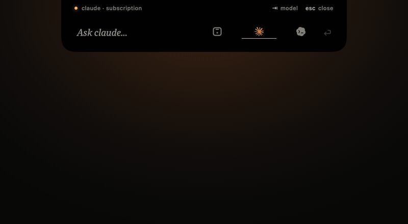
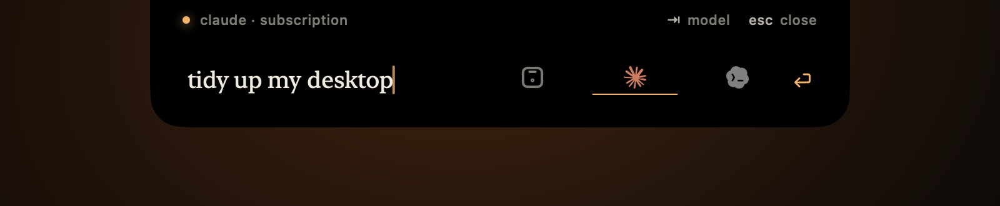
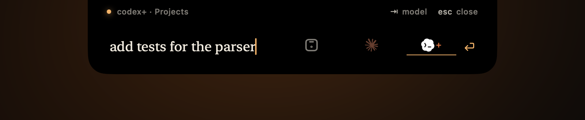
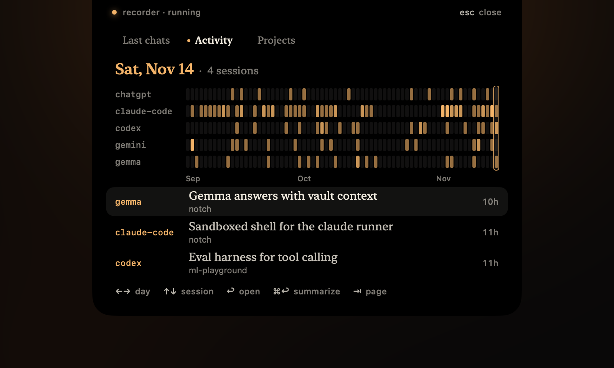
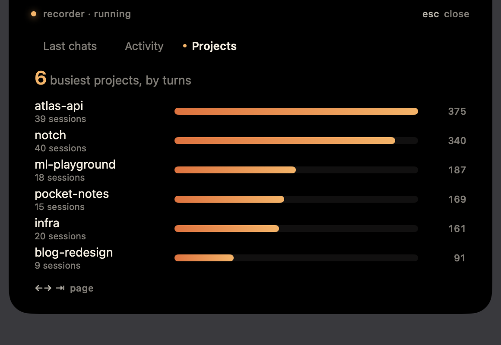
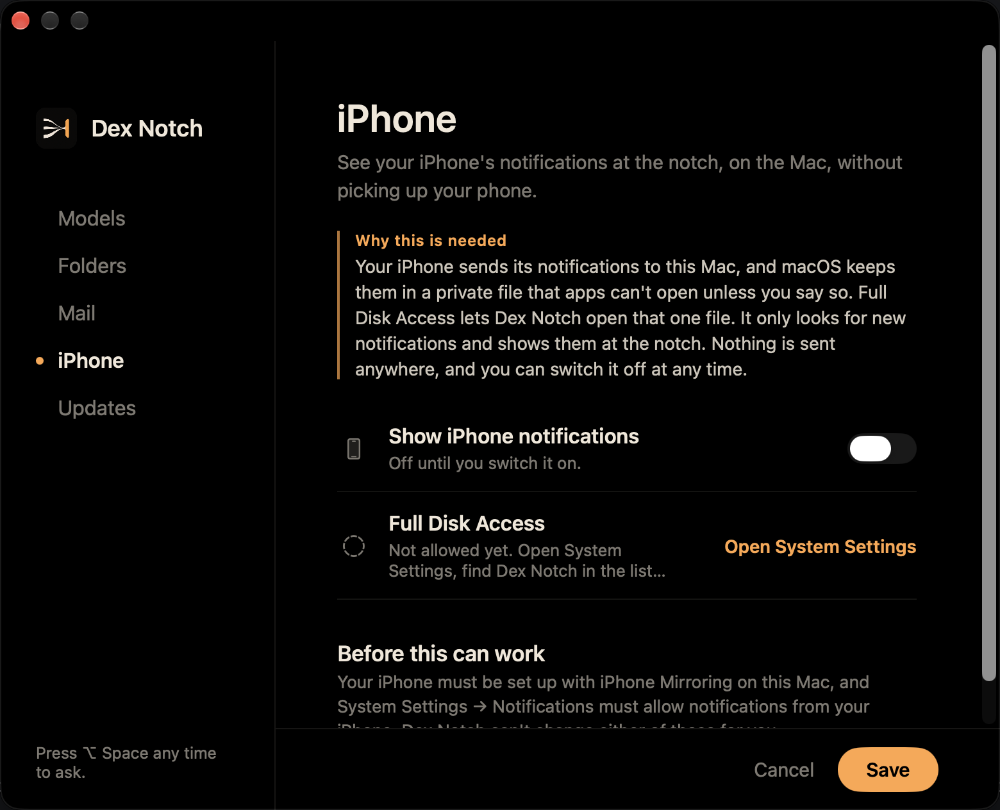

<p align="center">
  
</p>

<p align="center">
  
</p>

<p align="center">
  
  
  
  
  
  
</p>

<p align="center">
  <b>Press a key. The notch opens. Ask Claude, Codex or a model on your own server, every conversation you have with any AI lands in one searchable memory they can all read, and when an email that actually needs you arrives (Gmail or Outlook), or a notification from your iPhone, the notch tells you in two lines.</b>
</p>

<p align="center">
  <a href="docs/install.md">Install guide</a> &nbsp;|&nbsp; <a href="#get-started-in-two-minutes">Quick start</a> &nbsp;|&nbsp; <a href="CHANGELOG.md">What's new</a> &nbsp;|&nbsp; <a href="#add-ons-mail-and-iphone">Mail and iPhone alerts</a> &nbsp;|&nbsp; <a href="PRIVACY.md">Privacy</a>
</p>

<p align="center">
  
</p>

---

## No API keys. Your regular subscriptions.

Dex Notch never asks for an OpenAI or Anthropic API key and never bills you per token.

| Model | What runs it | What it uses |
|---|---|---|
| **Claude** | the official `claude` CLI, launched headless | your **Claude subscription** login |
| **Codex** | the official `codex` CLI, launched headless | your **ChatGPT subscription** login |
| **Local model** (optional) | a model on your own machine, through Ollama | your own hardware. The only credential is a token for *your* server |

The app does not read, copy or reuse your login tokens. It starts the same CLIs you already use in a terminal, so usage counts against your normal plan limits. If you can run `claude` or `codex` in a terminal, the notch can use it. One of them is enough.

---

## Get started in two minutes

1. **Download** the latest `dex-notch-*.dmg` from [Releases](https://github.com/Dextron04/dex-notch/releases/latest) and drag **Dex Notch** into Applications.
2. **Open it once and allow it.** The build is not notarized (that needs a paid Apple Developer ID), so macOS says it can't verify the app. On macOS 15 and later, go to **System Settings → Privacy & Security** and click **Open Anyway** next to Dex Notch (on macOS 14, right-click → Open). From Terminal, on any version: `xattr -dr com.apple.quarantine "/Applications/Dex Notch.app"`.
3. **Follow the short walk-through** that opens by itself, six steps with Back and Continue: pick your model, say where it may work, and (all optional) connect Gmail or Outlook and turn on iPhone notifications. Every step says in plain English why it asks for what it asks for, and every step can be skipped. Anything can be changed later in Settings.
4. **Press `⌥ Space`.**

<p align="center">
  
  <br><sub><b>First run.</b> It finds Claude and Codex for you and shows the exact install command for whatever is missing. Everything here is changeable later from the menu bar (<code>⌘ ,</code>).</sub>
</p>

Don't have `claude` or `codex` yet? The notch tells you what to install and waits:

<p align="center">
  
</p>

| Want | Add |
|---|---|
| **Just ask Claude or Codex from a hotkey** | nothing else. That is the DMG. |
| **A shared memory across all your agents** | the recorder: `cd memory && sh install.sh` ([below](#shared-memory-the-recorder)) |
| **A model on your own server** | Menu bar → **Settings…** → *Models* → *Local model*, or [edit `settings.json`](#settings) |
| **Your important email at the notch** | Menu bar → **Settings…** → *Mail* → **Connect Gmail** or **Connect Outlook** ([below](#add-ons-mail-and-iphone)) |
| **Your iPhone's notifications at the notch** | Menu bar → **Settings…** → *iPhone* → switch on, and allow Full Disk Access ([below](#iphone-notifications)) |
| **ChatGPT and Claude.ai reading your memory** | the [remote connector](#for-chatgpt-and-claudeai) |

---

## Every view

### Ask

<table>
  <tr>
    <td width="50%"></td>
    <td width="50%"></td>
  </tr>
  <tr>
    <td align="center"><sub><b>Quiet.</b> No row of logos. The top-left says which model is on and what it may do.</sub></td>
    <td align="center"><sub><b>Switch and it says so.</b> <code>⇥</code> or <code>⌘1</code> <code>⌘2</code> <code>⌘3</code> and the notch names the model once, its logo and name with an ember line that runs out, then it is gone.</sub></td>
  </tr>
  <tr>
    <td colspan="2" align="center"></td>
  </tr>
  <tr>
    <td colspan="2" align="center"><sub><b>Edit rights.</b> <code>⌘E</code> adds a <b>+</b>: it may edit files and run sandboxed commands. <code>⌘F</code> picks the folder. A model on your own server gets its own mark, the notch cut into a rounded square, and the top-left shows your host.</sub></td>
  </tr>
</table>

<p align="center">
  
  <br><sub><b>Answers with receipts.</b> Code gets its own block with a copy button. When the local model drew on your memory, a line under the answer names the notes it used.</sub>
</p>

### Recall

Press `⌥⇧ Space` to see what you and your agents have been doing.

<table>
  <tr>
    <td width="50%"></td>
    <td width="50%"></td>
  </tr>
  <tr>
    <td align="center"><sub><b>Last chats.</b> Where you left off with every agent. <code>↩</code> opens the note in Obsidian, <code>⌘↩</code> summarizes it.</sub></td>
    <td align="center"><sub><b>Activity.</b> Ten weeks, per agent. <code>←</code> <code>→</code> move the day.</sub></td>
  </tr>
</table>

<p align="center">
  
  <br><sub><b>Projects.</b> Where the conversation actually went.</sub>
</p>

<sub>Screenshots use a synthetic vault and demo settings (`scripts/demo_vault.py`), not real conversations. The Claude and Codex logos belong to Anthropic and OpenAI and only identify those products; see [NOTICE.md](NOTICE.md). The local-model mark is original.</sub>

---

## The problems this solves

| The problem | What Dex Notch does about it |
|---|---|
| **Every AI is an island.** What you decided with Claude Code is invisible to Codex, Gemini and ChatGPT. | A recorder turns every session into a redacted markdown note in one Obsidian vault. Every agent can search it. |
| **Setup that takes an afternoon.** | A DMG and one window. It finds your CLIs, tells you the install command for what's missing, and asks where edit runs may write. |
| **Switching model means retyping `@names`.** | `⇥` or `⌘1/2/3`, and the notch names the model once, then clears. Typing `@claude ` still works and switches the model. |
| **A local model that makes things up about your own work.** | Before each local-model answer the notch searches your vault, hands the model the best snippets, and names the notes it used. |
| **"Can it run code?" without giving a model your machine.** | `+` turns on edit rights *and* a shell, inside an OS sandbox: no network, and writes only to a scratch folder plus the folders you chose. |
| **Click away, lose the chat.** | The conversation survives closing the notch, quitting and restarting. It starts fresh after 30 idle minutes or on `⌘N`. |
| **Transcripts are full of secrets.** | Redaction runs before anything is written: provider keys, bearer tokens, URL credentials, `password=`-style assignments. |
| **ChatGPT and Claude.ai can't see any of it.** | A remote MCP connector with real OAuth gives their web and phone apps read access, plus a `remember` tool to save a chat on request. |
| **You can't see your own AI habits.** | The recall view: last chats, a per-agent heatmap, and a projects ranking. |
| **Paying twice for the same models.** | No API keys. It rides the subscriptions you already have. |

---

## How it works

<p align="center">
  
</p>

1. **Capture.** A launchd agent polls each tool's own log every 30 seconds, resuming from a byte offset and ignoring half-written lines. Adapters exist for Claude Code, Codex, Gemini/Antigravity and the notch's own local-model chats.
2. **Redact, then write.** Secrets are stripped before text reaches disk. Notes are idempotent: every section carries a hash marker, so crashes, restarts and duplicate session copies never create duplicates.
3. **One vault.** Plain markdown under `Sessions/<agent>/<month>/`, with generated `Index`, `Agents`, `Projects` and `Days` hub notes so Obsidian's graph view clusters your work.
4. **Read it anywhere.** The notch recall view; an MCP server (`vault_search`, `vault_recent`, `vault_read`) for Claude Code, Codex and Gemini; a start-up digest so Claude Code opens already briefed; a semantic RAG index; and a remote connector for ChatGPT and Claude.ai.

**The notch itself** is a borderless, non-activating panel pinned to the top centre of the notched display. It never resizes, because a content-driven resize drifts the window off-centre. The SwiftUI pill animates inside it. On a Mac without a notch it draws a notch-sized pill at the top centre of the screen.

---

## Keys

**Ask** (`⌥ Space`)

| Key | Action |
|---|---|
| `↩` | send |
| `⇥` / `⇧⇥` | next / previous model |
| `⌘1` `⌘2` `⌘3` | the 1st, 2nd, 3rd model you have |
| `⌘E` | allow edits and sandboxed commands (Claude, Codex) |
| `⌘F` | cycle the folder edit runs may write to (your scratch sandbox, then each folder you allowed) |
| `⌘N` | new conversation |
| `⇧⌘C` | copy the answer |
| `esc` | close. The chat stays. |

**Recall** (`⌥⇧ Space`)

| Key | Action |
|---|---|
| `⇥` or `←` `→` | switch page. On Activity, `←` `→` move the day |
| `↑` `↓` | move through sessions |
| `↩` | open the note in Obsidian |
| `⌘↩` | three-line summary from the model |
| `/` | search titles, projects and agents |

**Mail alert** (only while a card is showing; they are global keys that vanish when it does, so they never eat your typing)

| Key | Action |
|---|---|
| `⌥↩` | open the email in the right Gmail inbox |
| `⌥⌫` | **Not important**: never show mail from this sender |
| `⌥esc` | dismiss |

**Menu bar:** **Settings…** (`⌘ ,`), Recall, **Check mail now**, **Open settings.json**, Check connection, Quit.

---

## Settings

The settings window writes `~/Library/Application Support/NotchApp/settings.json`. To edit the file by hand, use **Open settings.json** in the menu bar, or **Edit settings.json** in the settings window (`~/Library` is hidden in Finder, so these save you the hunt). Every key is optional, unknown keys are kept, and the file is re-read whenever you press `⌥ Space` or **Check connection**.

```json
{
  "default": "claude",
  "workspace": {
    "default": "~/Projects",
    "folders": ["~/Desktop", "~/Downloads", "~/Projects"]
  },
  "gemma": {
    "host": "ai.example.com",
    "model": "gemma3:12b"
  },
  "addons": {
    "check_minutes": 5,
    "max_model_calls_per_hour": 8,
    "order": ["claude", "codex", "gemma"],
    "importance": "Recruiters, my landlord, anything about payments."
  }
}
```

| Key | Meaning |
|---|---|
| `default` | `"claude"`, `"codex"` or `"gemma"` (the local model). Which one starts selected. Ignored if that model isn't available. |
| `workspace.default` | The folder edit runs may write to by default. Leave it out to use only the scratch folder. |
| `workspace.folders` | The folders `⌘F` cycles through. Leave it out for Desktop, Downloads, Documents and Projects. |
| `gemma.host` | Your Ollama server's hostname (HTTPS only). A pasted `https://…/` is tidied. |
| `gemma.model` | The model name your server knows (`ollama list`). There is no default. |
| `gemma.keychain_service` / `keychain_account` | Where the token lives in your Keychain. Default: the host, and `notchapp`. |
| `addons.check_minutes` | How often to look for new mail while the Mac is awake. Default 5, from 2 to 1440. Also a choice in Settings → Mail. |
| `addons.max_model_calls_per_hour` | A ceiling on how often the AI reads mail. Default 8. |
| `addons.order` | Which model reads your mail first, then the fallbacks. Default `claude`, `codex`, `gemma`. |
| `addons.importance` | One or two lines on what matters to you. Added to the rules that decide what interrupts you. |
| `addons.phone_alerts` | `true` shows iPhone notifications at the notch (see [iPhone notifications](#iphone-notifications)). Off by default. Also a switch in Settings → iPhone. |
| `addons.microsoft` | `client_id` of your own Microsoft application for Outlook sign-in (see [Outlook](#outlook-and-microsoft-365)). Release builds carry their own. |
| `addons.gmail` | `client_id` and `client_secret` of your own Google client. Only needed when building from source; release builds carry their own. |

**Folder rules.** A folder must exist, sit *inside* your home folder, and not be your home folder itself, a hidden top-level folder (`~/.ssh`, `~/.aws`, …) or `~/Library`. `..` and symlinks can't be used to escape. Rejected entries are reported and ignored; the rest still apply.

### Add a local model later

Skip it on day one and add it whenever you like:

1. Run [Ollama](https://ollama.com) somewhere you control and put it behind HTTPS with a bearer token (Caddy and a Cloudflare tunnel work well).
2. Menu bar → **Settings…** → *Models* → **Set up** on *Local model*, fill in the host, the model name and the token, and **Save**. The token goes into your Keychain (through Apple's `security` tool, so updates never trigger a password prompt), never into `settings.json`.
3. It joins the models you can switch between with `⇥`.

Without it everything else works, with two models to switch between.

**How it uses your memory.** Every question to the local model carries a short briefing: what the vault is, to use a note only if it is clearly about the question, to name it, and to say so when nothing matches instead of guessing. Questions about time or about the vault itself ("what did I work on today?", "what's in my vault?") also get an overview built from the vault's own files (counts, today's sessions, the latest sessions), because similarity search can't tell what "today" means. The model's own earlier answers are never offered back to it as facts.

**Keeping it fast.** A model that isn't in memory takes about a minute to load, which feels like the notch hanging. So the notch asks Ollama to keep the model for 30 minutes, loads it in the background the moment you open the notch on it, and caps every answer at 1,024 tokens so one runaway reply can't block the server. Ollama runs one request at a time by default; if several apps share the server, a long request from one will make the others wait.

---

## Add-ons: mail and iPhone

Dex Notch can watch your inbox and tell you at the notch about the few emails that actually need you. Most mail never reaches you.

<p align="center">
  
  <br><sub><b>One card, two lines.</b> What it is, and why it matters. The comet of light runs the edge of the card and fills it; that edge then drains over twelve seconds as the timer. Resting the pointer on the card holds it.</sub>
</p>

1. **Connect once.** Settings → *Mail* → **Connect Gmail**. It asks Google for read-only access; the sign-in token goes in your Keychain. **Add as many accounts as you like**: each is listed with a **Remove** link, and a card says which account the mail came to. Release builds carry their own Google sign-in. Building from source, or want your own? Under *Use your own Google client*, paste an OAuth client of type *Desktop app* (Gmail API on). See [PRIVACY.md](PRIVACY.md).
2. **It looks for new mail every 5 minutes** while the Mac is awake, and you can change that (2 minutes to 4 hours) in Settings → Mail → *How often to look*. A look is a single light request per account; only the sender, subject and a short preview are read in the background; a whole email is read only when you ask to reply to it or ask about it.
3. **The AI only reads what is new.** Spam, promotions, social and forum mail are dropped first, for free, and so is anything already judged. A model then scores what is left against strict rules (a real person waiting on you, a deadline, a meeting change, a failed payment, a delivery today) and only a 7 out of 10 or better gets through, at most three per check. It waits a minute after mail lands so a burst becomes one call, and it is capped at 8 calls an hour so it can't eat your Claude or Codex limits. A third filter is you: **Not important** mutes that sender for good.
4. **Claude first, then Codex, then your local model.** If one is rate-limited, logged out or offline, the next takes over. *What matters to you* in Settings adds a line of your own ("recruiters and my landlord") to the rules.
5. **Reply from the notch.** **Reply** (`⌥R`) on a card grows it into a reply panel: an AI agent drafts an answer you can edit, you can ask it to change it ("shorter", "say Thursday doesn't work"), switch the agent (Claude, Codex or your local model), and ask follow-up questions about the email ("what does she want me to bring?"). Then **Send** (with five seconds to Undo; the edge of the panel is the countdown, and the draft folds into an envelope and flies out of the notch when it has gone) or **Save draft** to finish it in Gmail. The AI only writes the text: the recipient and subject come from the original email and nothing is sent until you press Send. Replying needs one more Google permission (to create drafts and send mail). It is asked for when you connect an account, unless you turn **Allow replies** off in Settings → Mail; an account without it stays read-only and offers **Allow replies** when you press Reply.
6. **It waits for you, and nothing is lost.** Alerts line up in the order the mail arrived, and the line is saved. A card only appears while you are at the keyboard (no keys or mouse for two minutes means it holds, then shows when you are back), never while the Mac is locked, and if you walk away mid-card it goes back in the line. With the lid shut and a monitor attached, the card appears in a notch-shaped pill at the top of the monitor. The menu shows *Show N waiting alerts*, and *Settings → Mail → Recent alerts* keeps the last few you were shown. When you wake or unlock the Mac, the notch opens with the card. `⌥↩` opens the thread, `⌥⌫` mutes the sender, `⌥esc` dismisses. Those keys exist only while a card is on screen.

<p align="center">
  
  <br><sub><b>Reply without leaving what you are doing.</b> An AI agent drafts it, you edit or ask for changes, then Send (with Undo) or Save draft.</sub>
</p>

<p align="center">
  
  <br><sub><b>Mail settings.</b> Accounts, how often to look, and what matters to you. (Demo accounts.)</sub>
</p>

Mail is treated as untrusted. The models run with no tools and no saved session (so mail never reaches the shared memory), their answers are checked against the ids they were sent, and the link opened is built by the app, never taken from model text.

### Outlook and Microsoft 365

**Settings → Mail → Connect Outlook** does for Outlook.com, Hotmail and work or school Microsoft 365 mailboxes what Connect Gmail does for Google: the same cards, the same filters, the same reply panel. Outlook's own *Other* tab plays the part of Gmail's Promotions tab, and **Save draft** puts the reply in your Outlook Drafts. Mix Gmail and Outlook accounts freely.

Sign-in needs an application ID from Microsoft. Release builds carry one; building from source, or want your own? It is free and takes about five minutes:

1. In [Microsoft Entra](https://entra.microsoft.com) → *App registrations* → **New registration**. Name it anything. For *Supported account types* choose **Accounts in any organizational directory and personal Microsoft accounts**.
2. *Redirect URI*: platform **Mobile and desktop applications**, value `http://localhost`.
3. *API permissions* → **Add a permission** → Microsoft Graph → *Delegated*: `Mail.Read`, `Mail.ReadWrite`, `Mail.Send`, `User.Read`, `offline_access`.
4. *Authentication* → **Allow public client flows: Yes**.
5. Copy the **Application (client) ID** into Settings → Mail → *Use your own Microsoft application*, or put it in `settings.json` as `addons.microsoft.client_id`. A work or school tenant may need an admin to approve the permissions.

IMAP and other mail providers are not supported yet.

### iPhone notifications

Notifications from your iPhone can show at the notch too, so you don't have to pick up your phone. They reach your Mac through **iPhone Mirroring**, and Dex Notch reads them from the file where macOS keeps notifications.

1. **Set up iPhone Mirroring** on your Mac and iPhone, and in System Settings → Notifications allow notifications from your iPhone. Dex Notch can't do either for you.
2. **Settings → iPhone** (or the walk-through): switch on **Show iPhone notifications**.
3. **Allow Full Disk Access.** macOS keeps notifications in a private file that apps can't open unless you allow it. The page has an **Open System Settings** link and a live check that turns green the moment you allow it. Add Dex Notch with **+** if it isn't listed, and reopen the app if macOS asks.

<p align="center">
  
</p>

It only shows what arrives after you switch it on, never your old notifications. A card shows the iPhone, the app, and what it said. **Done** (`⌥↩`) closes it and **Not important** (`⌥⌫`) hides that app for good. There is no AI involved, and nothing leaves your Mac. A notification counts as the phone's when its app isn't installed on your Mac; an app that exists on both is treated as the Mac's own. See [PRIVACY.md](PRIVACY.md).

## Updates

Dex Notch updates itself, so nobody needs to come back to GitHub for a new DMG.

- **Once a day** it looks for a newer release, and **downloads it quietly in the background**.
- It checks the download against a signing key built into the app. A file that was changed, or that was not signed by this project, is refused.
- It then **asks before it restarts**: a small dot appears next to the menu bar mark, and the menu offers *Restart to update to …*. Settings → *Updates* shows the same with **Restart now**. If you just quit instead, the update is installed on the way out.
- Because the update comes from inside the app, macOS never asks you to allow it again: the *Open Anyway* step is only for the very first install.
- **Settings → Updates** has *Check now* and a switch to turn automatic updates off. The menu bar has *Check for Updates…*.

Updating is [Sparkle](https://sparkle-project.org) (MIT licence). A release attaches an `appcast.xml` that the app reads from `releases/latest/download/appcast.xml`; the release build signs each update with the `SPARKLE_PRIVATE_KEY` secret and the matching public key is in `project.yml`. Debug builds don't check for updates unless you set `NOTCH_UPDATES=1`.

## Safety model

| | Local model | Claude (`@claude`) | Codex (`@codex`) |
|---|---|---|---|
| **Ask (default)** | no tools; vault snippets only | read, search, web, vault tools. **No shell, no edits.** | read-only sandbox |
| **Edit + run (`+`)** | not available | edits, plus a shell in Claude Code's OS sandbox | `workspace-write` sandbox |
| **Where it can write** | nowhere | the scratch folder, plus the one folder you selected | the scratch folder, plus the one folder you selected |
| **Network from commands** | n/a | blocked | blocked |

- Edit runs cannot fall back to an unsandboxed shell.
- Only folders you allowed can be granted, one at a time, and each is re-checked right before a run.
- Private files (saved conversation, the local model's journal, OAuth state) are mode `600`. The token lives in the Keychain.
- The remote connector uses OAuth 2.1 with PKCE (S256 only), a redirect-host allow-list, hashed token storage, and a per-client lockout after five wrong passphrases.

---

## Shared memory (the recorder)

The app works on its own. To make your agents remember each other, install the recorder, which is Python standard library only:

```bash
git clone https://github.com/Dextron04/dex-notch && cd dex-notch/memory
sh install.sh                      # records into ~/Vault every 30 s
python3 -m agentvault backfill     # one-time import of your existing history
```

Let your agents read the vault:

```bash
claude mcp add agentvault -e PYTHONPATH=/path/to/dex-notch/memory -- python3 -m agentvault.mcp_server --vault ~/Vault
```

```toml
# ~/.codex/config.toml
[mcp_servers.agentvault]
command = "python3"
args = ["-m", "agentvault.mcp_server", "--vault", "/Users/you/Vault"]
env = { PYTHONPATH = "/path/to/dex-notch/memory" }
```

If you added a local model, the recorder also indexes your vault on that server for semantic search. It reads the same `settings.json` and the same Keychain token, through Apple's `security` tool, so macOS never asks for your password again after an update.

### For ChatGPT and Claude.ai

Run the connector on an always-on machine behind a tunnel, then add its URL as a custom connector in either app:

```bash
python3 -m agentvault.remote --vault ~/agentvault/Vault --state ~/agentvault/oauth.json \
  --passphrase-file ~/agentvault/passphrase --public-url https://memory.example.com
REMOTE=host:agentvault/Vault sh install.sh   # keeps both vault copies in step
```

---

## Honest limits

- **The DMG is not notarized.** The first launch needs one extra step (Privacy & Security → Open Anyway on macOS 15 and later). Notarizing takes a paid Apple Developer ID.
- **Memory is a separate install for now.** The recorder and MCP server live in `memory/` and aren't bundled in the app yet. Without them the recall view is empty and the local model has no vault to search.
- **ChatGPT and Claude.ai chats are not captured live.** Neither exposes chat history to apps, and MCP is pull-only. The connector lets them *read* your vault and *save* a chat when you ask. A full import from the official data export is not built yet.
- **The local model is a chat model with retrieved snippets, not an agent.** It cannot open a note or run tools.
- **The vault is plain text.** Redaction is pattern-based. Treat the vault like any other folder of your private conversations.
- **iPhone notifications rely on an undocumented macOS file.** Apple does not document where Notification Center keeps notifications, so a macOS update could break it; Settings then says so instead of failing quietly. It needs Full Disk Access and iPhone Mirroring.
- **Edit runs are powerful.** An edit run with Desktop allowed can rearrange it, with no confirmation prompt. Ask for a plan first if it matters.

---

## Build from source

**Requirements:** macOS 14+, Xcode 16 (Swift 6), [XcodeGen](https://github.com/yonaskolb/XcodeGen).

```bash
brew install xcodegen
xcodegen generate
xcodebuild -scheme NotchApp -configuration Debug build   # or open NotchApp.xcodeproj
scripts/make-dmg.sh v0.2.0                               # a universal, ad-hoc signed "Dex Notch.app" in a DMG and zip in build/dist/
```

Releases are built by GitHub Actions: push a tag (`git tag v0.2.0 && git push --tags`) and a DMG is attached to a new release. CI runs every test on each push. A release also carries the app's own Google sign-in, read from the `GOOGLE_CLIENT_ID` and `GOOGLE_CLIENT_SECRET` repository secrets.

**Demo mode.** `NOTCH_VAULT`, `NOTCH_SETTINGS` and `NOTCH_CLIS` (for example `none`, or `claude,codex`) point the app at other data or pretend which CLIs are installed. `NOTCH_ADDONS` points the alert queue and accounts at a throwaway file, `NOTCH_ALERT_DEMO` (`gmail`, `phone`, or anything else for all of them) shows made-up alert cards, and `NOTCH_OPEN_SETTINGS` (`models`, `folders`, `mail`, `iphone`, `updates`) opens Settings on a page. That is how the screenshots here were made, and how to rehearse the first run:

```bash
python3 scripts/demo_vault.py /tmp/demo-vault
NOTCH_VAULT=/tmp/demo-vault NOTCH_SETTINGS=/tmp/none.json NOTCH_CLIS=none open "path/to/Dex Notch.app"
```

### Project layout

```
NotchApp/                 SwiftUI + AppKit menu-bar agent
  NotchWindow.swift         the fixed-size panel and key handling
  NotchView.swift           pill, wings, the model announcement, transcript, setup card
  ModelMark.swift           the model marks: official Claude and Codex logos, plus the local-model mark
  SVGPath.swift             reads SVG path data so the real vector logos can be drawn (tested)
  SetupView.swift           the settings window and the first-run walk-through: a rail and one page at a time (Models, Folders, Mail, iPhone, Updates)
  Addons.swift              mail triage: filters, the model prompt, parsing, settings and state; also reads iPhone notifications from Notification Center (pure, tested)
  Gmail.swift               Google sign-in (PKCE), the Gmail client, one token per account (tested)
  Outlook.swift             Microsoft sign-in, the Outlook client (Microsoft Graph), and the mail-provider interface (tested)
  AddonCenter.swift         schedule, accounts, model fallback, and when a card may appear
  AlertView.swift           the mail card and its arrival: the comet round the rim, the rim as a timer
  Hotkey.swift              global hotkeys (the model hotkeys and the card keys)
  AppUpdater.swift          updates through Sparkle: check daily, download quietly, ask before restarting
  Assistant.swift           state, local-model streaming, vault recall, persistence
  AgentStream.swift         routing, CLI arguments, stream parsing (pure, tested)
  AgentRunner.swift         launches claude / codex headless
  Settings.swift            settings.json: models, workspace, folder rules (pure, tested)
  RecallView.swift          chats, heatmap, projects
  VaultReader.swift         reads the vault the recorder writes
memory/
  agentvault/               recorder, adapters, redaction, MCP server, RAG push
    remote/                 OAuth + MCP over HTTP for ChatGPT and Claude.ai
  hooks/                    Claude Code start-up digest
  tests/                    118 tests
NotchAppTests/             205 tests
scripts/                   make-dmg.sh, appcast.sh (the update feed), demo_vault.py
.github/workflows/         CI and release
docs/                      specs, plans, example settings, assets
```

```bash
xcodebuild test -scheme NotchApp -destination 'platform=macOS'   # 205 Swift tests
cd memory && python3 -m unittest discover -s tests               # 118 Python tests
```

Everything here was built test-first where it could be: the stream parsers, the sandbox arguments, the folder rules, the OAuth flows, the mail filters, the lockout, the redaction rules, the idempotent note writer.

## License

[MIT](LICENSE). Use it, change it, ship it. The Claude and Codex logos are their owners' trademarks and are not covered by that licence: see [NOTICE.md](NOTICE.md).
